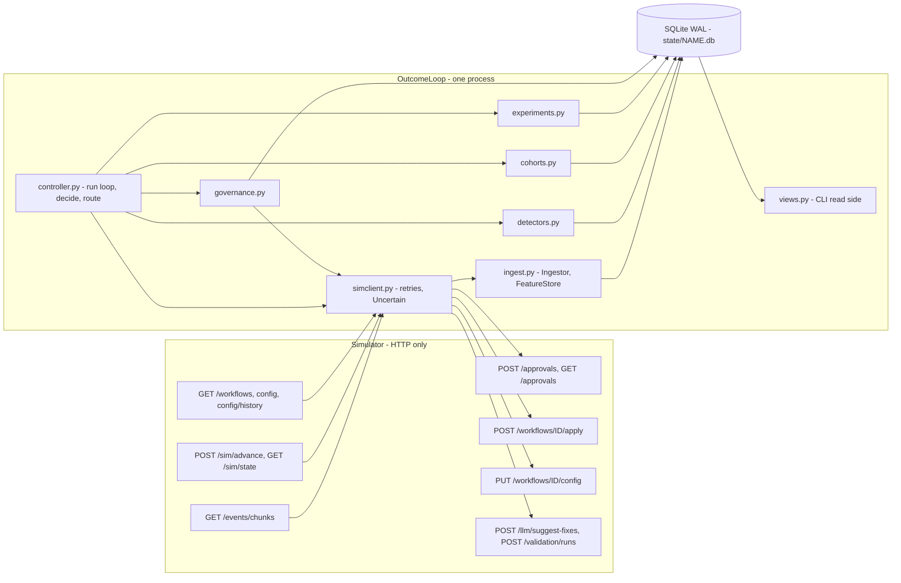
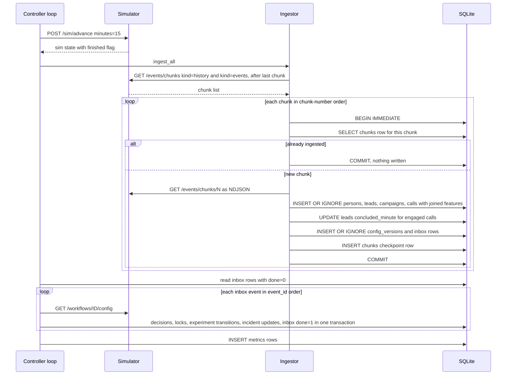
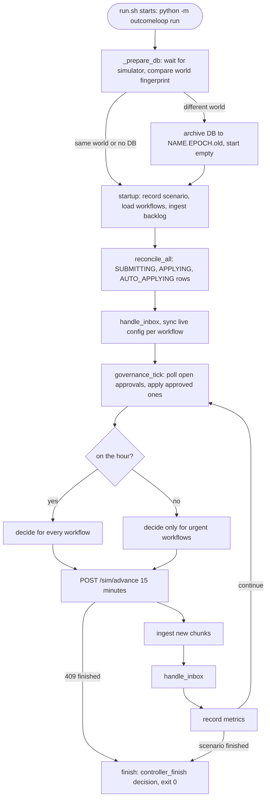
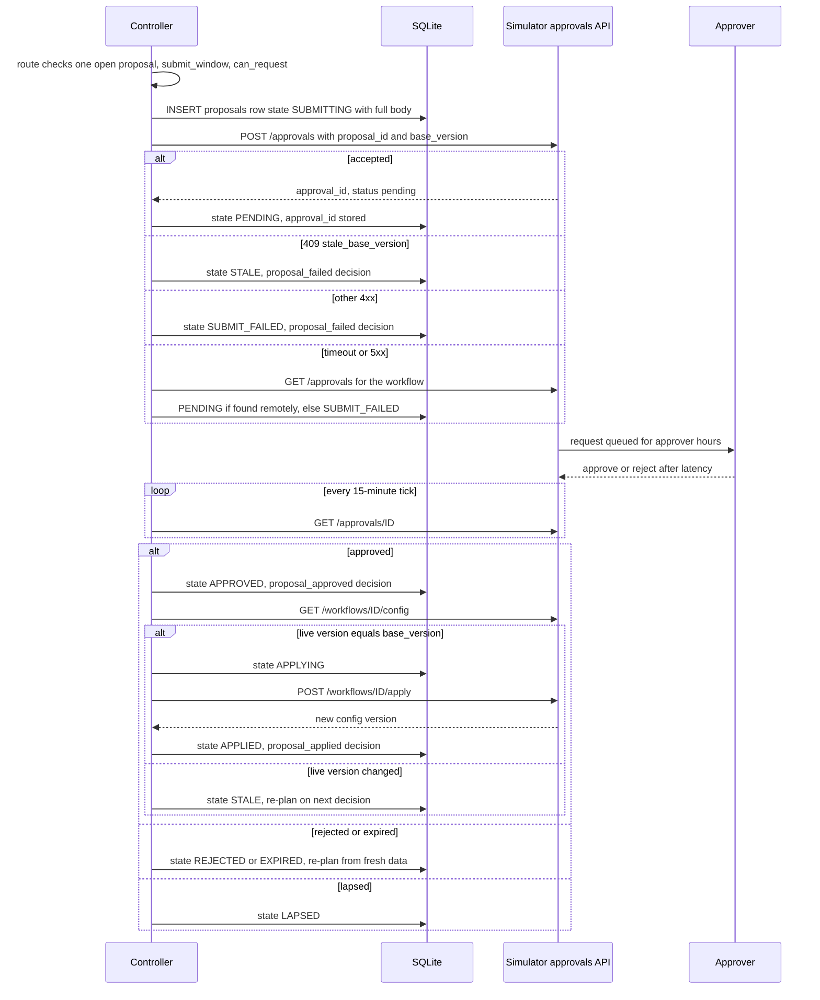
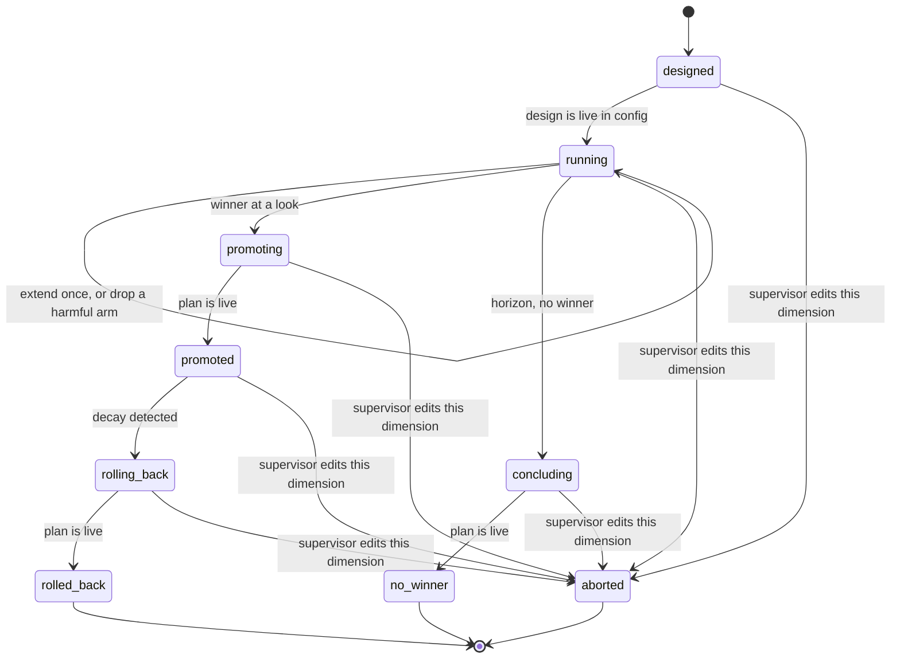
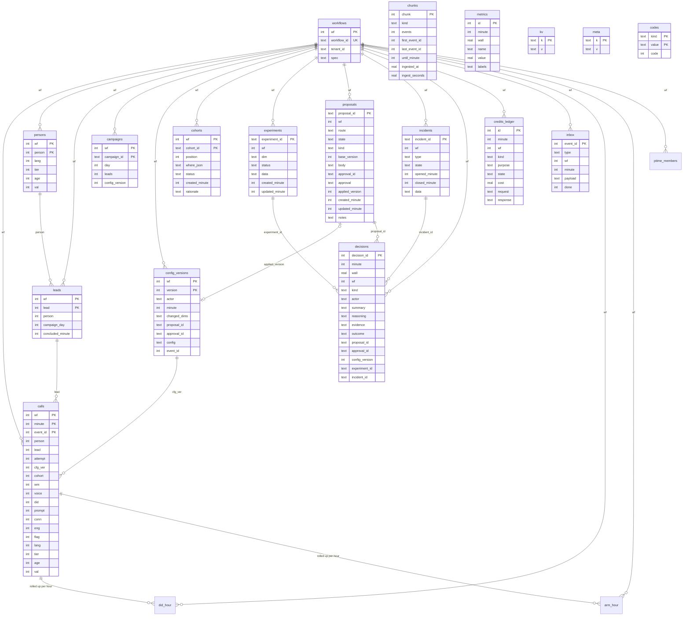
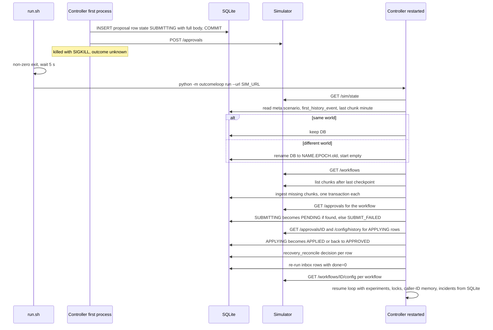

# OutcomeLoop

An autonomous, governed optimisation controller for outbound voice-agent workflows.

OutcomeLoop is one Python process with one SQLite file. It drives the Formi closed-loop simulator over HTTP. For
every workflow it ingests call events exactly once, keeps one shared cohort definition, detects caller-ID and
hallucination incidents on populations (never on single calls), runs welcome-message and voice experiments with
a sequential test that bounds the false-winner rate, and sends every change through the governance boundary.
That means one batched approval request per workflow, or a policy-permitted auto-apply for operational
settings. Every decision, including each decision to wait, is written to an append-only audit table. That
table answers "why did workflow X change at time T, who approved it, and what happened next?" without touching
the simulator.

| Headline (from `reports/`) | Value |
|---|---|
| public_01 conclusion-rate lift vs no-op baseline, all workflows | `+15.3%` (0 harmful changes of 26) |
| public_02 conclusion-rate lift vs no-op baseline, all workflows | `+25.1%` (2 harmful of 28) |
| public_02 time to fix the supervisor's unsafe prompt (grader MTTR) | `90 min` (detected in 15 min; the rest is approver latency) |
| public_03 ingest throughput (4 vCPU / 8 GB container) | `~47,000` history, `~39,000` live events/s (`reports/scaling.md`) |
| public_03 controller seconds per simulated day (container, 1×) | `49 s` (SRE target 600 s; ≈ 460 s *projected* at 10×) |
| public_03 peak controller memory | `361 MB` (was 1,046 MB; `reports/memory.md`) |
| Tests | `224` (222 unit + 2 slow integration) |
| Crash-recovery run (kill / restart / verify) | `9 hard kills, 20 verification checks, 0 failed` |
| Robustness suite (7 generated scenarios × 2 seeds + 2 public seeds) | `16/16` pass, 0 decision errors, 0 false winners in 15 null experiments |

The full figures are in `reports/public_01_dev.md`, `reports/public_02_incidents.md`, `reports/public_03.md`,
`reports/crash_recovery_timeline.json` and `reports/crash_public_02_grade.md`. Reasoning, stakeholder replies
and scope choices are in `SUBMISSION.md`. The engineering spec is `docs/DESIGN_DECISIONS.md`.

Other documents:

- `docs/ARCHITECTURE.md`: module by module, the data model, the decision tick step by step, and extension points.
- `docs/OPERATIONS.md`: the on-call runbook.
- `docs/WALKTHROUGH.md`: ten commands that rebuild one real decision from the audit store.

---

## Contents

1. [Problem statement](#problem-statement)
2. [Goals and non-goals](#goals-and-non-goals)
3. [Core features (C1–C15)](#core-features-c1c15)
4. [Architecture](#architecture)
5. [Technology stack](#technology-stack)
6. [Repository structure](#repository-structure)
7. [Component responsibilities](#component-responsibilities)
8. [End-to-end event flow](#end-to-end-event-flow)
9. [Autonomous decision lifecycle](#autonomous-decision-lifecycle)
10. [Cohort architecture](#cohort-architecture)
11. [Statistical experimentation](#statistical-experimentation)
12. [Governance and approval lifecycle](#governance-and-approval-lifecycle)
13. [Rollback and decay](#rollback-and-decay)
14. [Caller-ID health](#caller-id-health)
15. [Hallucination incidents](#hallucination-incidents)
16. [Persistence model](#persistence-model)
17. [Idempotency and crash recovery](#idempotency-and-crash-recovery)
18. [Security and operational considerations](#security-and-operational-considerations)
19. [Observability](#observability)
20. [Performance and scalability](#performance-and-scalability)
21. [Limitations and trade-offs](#limitations-and-trade-offs)
22. [Setup](#setup)
23. [Environment variables](#environment-variables)
24. [Running the controller](#running-the-controller)
25. [Running each scenario](#running-each-scenario)
26. [Tests](#tests)
27. [Load test](#load-test)
28. [Crash recovery test](#crash-recovery-test)
    - [Robustness suite (out-of-sample evaluation)](#robustness-suite-out-of-sample-evaluation)
    - [Docker](#docker)
29. [Interpreting reports](#interpreting-reports)
30. [Troubleshooting](#troubleshooting)
31. [Future improvements](#future-improvements)
32. [Assignment](#assignment)

---

## Problem statement

Formi's outbound voice agents (insurance renewals, KYC follow-ups, cancellation reconfirmations) run on a
configuration that a human sets once and rarely revisits. That configuration covers the welcome message, voice,
caller ID, prompt version, and which hours each kind of person is called in. Two KPIs decide whether a
workflow is healthy, and they are never blended:

- **pickup rate** = connected ÷ dials
- **engagement rate** = engaged ÷ connected

Each workflow declares one KPI as `primary` and puts a `guardrail` on the other. The business outcome above
both is leads concluded ÷ leads uploaded.

The controller has to notice what works, test better options on the right people, ask for permission in a form
a busy supervisor can approve, apply changes safely, back out when something stops working, and explain all of
it from its own records. It has to do this for many workflows at once, under eight constraints that cannot be
negotiated:

1. absolute governance boundary
2. the business owns whether and when to call
3. separate KPIs
4. statistical, deterministic winner selection
5. population-level detection
6. auditability from our own store
7. finite credits
8. crash safety

## Goals and non-goals

**Goals**

- Run `./run.sh <SIM_URL>` to completion on any scenario with the public schema, with no manual steps and
  without reading anything the HTTP API does not return.
- Never break the governance boundary or overwrite a supervisor edit silently.
- Improve each workflow's primary KPI without breaching its guardrail, with a bounded false-winner rate.
- Survive `kill -9` at any instant: no double apply, no lost approval, no forgotten learning.
- Answer "why did X change" from our own store.
- Keep up with `public_03_load` (12 workflows, about 650k dials/day) on a 4-vCPU / 8 GB box.

**Non-goals**

- Changing cadence, dialling windows or capacity. These are business-owned, and the controller only decides
  *who* is called in an hour and *how* the agent sounds.
- Rolling out per-person call time (`lead_preferred_hour`) without evidence. It runs as a randomised experiment instead: see C4.
- Letting an LLM decide anything. It only proposes prompt candidates, and validation plus a deterministic rule
  decide.
- Sharing winners across tenants. A winner changes only its own workflow.
- A web UI. The supervisor view is a CLI over the same store.
- Fair allocation of credits and attention across tenants (C15, cut).

## Core features (C1–C15)

Status comes from the code in `src/outcomeloop/`, not from intent.

| # | Capability | Status | Where / how |
|---|---|---|---|
| C1 | Event ingestion: backlog-safe, idempotent, restartable | **Built** | `ingest.py`. One transaction per chunk (rows + `chunks` checkpoint). `INSERT OR IGNORE` on natural keys. History backlog and live chunks go through the same path. |
| C2 | Lead/feature joins, one shared cohort object | **Built** | Features are joined onto every `calls` row at ingest. `cohorts.membership_sql` is the single implementation of first-match membership. The same cohort set is written into `config.cohorts` and used by detectors, experiments and the supervisor view. |
| C3 | Bootstrapping from pre-D0 history | **Built** | `Controller.bootstrap`: cohort feature by likelihood-ratio test, smoothed call-hour weights, QA-flag reference rate. Experiment baselines use the last 7 days, which include history. |
| C4 | Call-time optimisation | **Built** | Cohort-level `schedule.hour_weights` (`cohorts.schedule_weights`) plus per-person preferred hours as a randomised, self-terminating experiment (`persontime.py`; only where `schedule` is auto-appliable). Ablation over 16 runs: +0.93 pp (`reports/ablation_person_time.md`). |
| C5 | Caller-ID health: detect, rotate, explore | **Built** | `detectors.did_health` (fast/slow windows) and the `Controller.detect_did` state machine (healthy/degraded/probe). Equal split over healthy numbers, rest then a time-boxed 2 % re-probe, ramped auto-apply. |
| C6 | Welcome × voice experimentation | **Built** | `experiments.py`: factorial design, planned n, O'Brien-Fleming alpha spending as an explicit budget, Holm, guardrail, harm stopping, cohort harm check, stability check, one pre-registered extension. Interaction check within the other dimension's dominant option before promotion. |
| C7 | Promotion, decay detection, rollback | **Built** | Promotion keeps a 15 % holdout. `decay_check` compares the current lift with the 80 % LCB of the lift at promotion. Rollback goes through approval and blacklists the option for 7 days. |
| C8 | Hallucination incident response | **Built** | Validation probe of supervisor prompt edits, two-signal confirmation for flag-rate spikes, known-good prompts first then the LLM, deterministic selection, engagement verification after apply, 40 % credit reserve. |
| C9 | Governance client | **Built** | `governance.py`: state machine, one open proposal per workflow, submit window based on worst-case latency, fatigue cap with incident slot and tenant preferences, expired = rejection, stale = re-plan, auto-apply only for operational dims with `max_shift` ramping, reconciliation. |
| C10 | Impact score, affected leads, dry run | **Built** (simple) | Present on every proposal (`Controller.impact`, `affected_leads`, `dry_run`), each with its basis. Impact is an ordinal heuristic with fixed scores for some change types. Dry runs are our own experiment evidence or historical re-weighting, not a full replay. |
| C11 | Consolidated supervisor view | **Built** | `python -m outcomeloop supervisor <wf>` and the read-only HTTP front `serve-views` (`/supervisor/<wf>`, `/why/<wf>`, `/status`, `/alerts`, `/customer/<person>`). |
| C12 | Queryable decision/audit store | **Built** | `decisions` table with UPDATE/DELETE blocked by triggers. CLI commands `why`, `audit`, `customer`. |
| C13 | Crash recovery, demonstrated | **Built** | Intent rows before HTTP, reconcile on start, `run.sh` restart loop. `scripts/crash_recovery.sh` hard-kills at 9 state-targeted moments and verifies. |
| C14 | Observability of the loop | **Partial** | `metrics` table, `status`, and `alerts` (paging rules evaluated from the store, exit 1 when one fires — cron/pager-ready). Not wired to a real pager. |
| C15 | Fair credits / attention across tenants | **Built (minimal)** | `fair_share_ok`: one credit pool, work-conserving fair share — a tenant waits (audited `hold`) only while another tenant has an open incident and it has used more than its equal share. Approver attention is per workflow (own approver, own fatigue cap). Exercised by `r7_credit_contention`. |

## Architecture

**Diagram A: system architecture.** Every box is a module or table that exists in the code.



The controller is single-threaded and synchronous. The simulator only moves when we call `POST /sim/advance`,
so concurrency would buy nothing, while determinism and crash safety buy a lot. The read-side CLI (`views.py`)
only opens the SQLite file. It works while the controller or the simulator is down.

## Technology stack

| Piece | Choice | Why |
|---|---|---|
| Language | Python 3.12 (3.11+ works) | Fast to write the statistics. Readable by the team. The simulator is already Python. |
| HTTP | `httpx` | Explicit timeouts. Lets us tell "connect failed before send" (safe to retry) apart from "sent, then timed out" (outcome uncertain). That distinction drives our idempotency rules. |
| Arrays | `numpy` | One use only: the in-memory `FeatureStore` (person index to packed lead features, `int32`), so joining features onto calls at ingest is a cheap array lookup. |
| Storage | stdlib `sqlite3`, WAL, `synchronous=FULL` | No new infrastructure (SRE memo). One file to back up, copy and inspect. Durable per-transaction commits are the basis of exactly-once ingestion and intent-before-HTTP. |
| Statistics | stdlib `statistics.NormalDist`, `math` | Normal approximations to two-proportion tests. Wilson-Hilferty chi-square tail for the cohort bootstrap. No SciPy. |

`requirements.txt` also lists `pyyaml`, `fastapi` and `uvicorn` (the simulator's dependencies) and `pytest`.
The controller imports only `httpx` and `numpy` beyond the standard library.

**Why no ORM, Redis or Postgres in the assignment.** The grader box runs `./run.sh` with nothing else
installed. A database server would be one more stateful thing to start, wait for and secure. The repository
layer is plain parameterised SQL, so an ORM would add a dependency and hide the transaction boundaries that
crash safety depends on. Redis adds nothing a durable checkpoint does not already give: there is no cross-process
state, and anything kept in Redis would still need a durable copy.

**How it maps to Postgres in production.** The schema uses only portable types (`INTEGER`, `TEXT`, `REAL`)
and `INSERT ... ON CONFLICT`. In production:

- `calls` becomes a table partitioned by day (and hash-partitioned by workflow at higher scale), with retention
  agreed with Compliance.
- `decisions` keeps its append-only triggers, or is revoked UPDATE/DELETE at the role level.
- `kv`, `proposals`, `experiments` and `incidents` stay ordinary tables.
- `BEGIN IMMEDIATE` becomes `SERIALIZABLE` (or row locks on a per-workflow checkpoint row).
- `WITHOUT ROWID` clauses are dropped. The only SQLite-specific behaviour is the per-connection page-cache pragma.

## Repository structure

```
.
├── run.sh                      # entry point: ./run.sh <SIM_URL>; restart supervisor around the controller
├── requirements.txt            # httpx, numpy (controller) + simulator and test deps
├── Makefile                    # baseline / serve / grade / test shortcuts
├── pytest.ini                  # testpaths=tests, 'slow' marker
├── config/
│   └── tenant_preferences.json # voluntary, stricter-than-policy tenant preferences (Kestrel: 11:00, 2/day)
├── src/outcomeloop/
│   ├── __main__.py             # CLI: run | why | supervisor | status | audit | decision | customer | alerts
│   ├── config.py               # Settings: every tunable constant + env loading
│   ├── controller.py           # the loop, decide(), desired config, routing, proposals, incidents, metrics
│   ├── ingest.py               # exactly-once chunk ingestion, feature join, inbox
│   ├── db.py                   # schema, transactions, string<->int codes, audit + metric writers
│   ├── simclient.py            # HTTP client: retry policy, Uncertain
│   ├── cohorts.py              # shared cohort object, membership_sql, bootstrap, call-hour weights
│   ├── detectors.py            # caller-ID health, hallucination spike, KPI drift
│   ├── experiments.py          # experiment lifecycle, looks, promotion, decay, rollback
│   ├── governance.py           # proposal state machine, timing, fatigue, auto-apply, reconciliation
│   ├── stats.py                # deterministic tests: compare, Holm, OBF spending, sample size
│   ├── timeutil.py             # sim minute <-> "D3 14:00", approver-hours arithmetic
│   └── views.py                # read-only views: why, supervisor, status, audit, customer
├── scripts/
│   ├── run_scenario.sh         # baseline (if missing) -> simulator -> run.sh -> sim grade
│   ├── load_test.sh            # public_03 run + reports/public_03.md
│   ├── load_report.py          # builds reports/public_03.md from our metrics/chunks tables
│   ├── crash_recovery.sh       # wrapper for crash_recovery.py
│   ├── crash_recovery.py       # hard-kill harness (7 targeted kills, restart, finish)
│   └── verify_recovery.py      # post-run invariants against our store, the sim API and the run dir
├── tests/
│   ├── conftest.py, fakes.py, helpers.py   # fixtures, a fake simulator, data builders
│   ├── unit/                   # stats, cohorts, config parity, db, ingest, detectors, experiments, governance
│   ├── integration/            # slow end-to-end tests (OUTCOMELOOP_SLOW=1)
│   └── test_sim.py             # simulator contract tests (shipped with the assignment)
├── reports/                    # sim grade output, load report, crash-recovery evidence
├── docs/
│   ├── ARCHITECTURE.md, OPERATIONS.md, WALKTHROUGH.md
│   ├── DESIGN_DECISIONS.md     # engineering spec (see ARCHITECTURE.md for where code differs)
│   └── SIMULATOR.md            # the simulator contract (assignment)
├── sim/, scenarios/, stakeholders/, examples/, SUBMISSION_TEMPLATE.md   # assignment material, unmodified
├── state/                      # (git-ignored) SQLite stores, one per run
└── runs/                       # (git-ignored) simulator run dirs and controller logs
```

## Component responsibilities

| Module | Responsibility |
|---|---|
| `__main__.py` | Argument parsing. `run` starts the controller. Every other subcommand opens the DB read-side and prints a view. |
| `config.py` | `Settings` dataclass holding every threshold. Loads `OUTCOMELOOP_DB` and `OUTCOMELOOP_TENANT_PREFS`. |
| `controller.py` | Startup, world-identity check, the tick loop, `decide()` per workflow, desired-config construction, routing to approval/auto-apply/hold, proposal assembly (summary, diff, affected leads, dry run, impact), incidents, metrics. |
| `ingest.py` | Lists and ingests chunks in order, one transaction each. Joins lead features onto calls. Queues `config_changed` / `approval_decided` events in `inbox`. |
| `db.py` | Schema, WAL/`synchronous=FULL`, nested-safe transactions, string-to-int code dictionary (reloaded after rollback), `kv` and `meta` helpers, append-only `decide()` and `metric()` writers. |
| `simclient.py` | The only path to the world. Retries idempotent GETs. Raises `Uncertain` for writes whose outcome is unknown. Never retries credit-spending calls. |
| `cohorts.py` | `Cohort`, `membership_sql`, load/save of the cohort set, history bootstrap by LR test, smoothed per-cohort call-hour weights with a re-weighting dry run. |
| `detectors.py` | `did_health` (per-number pickup vs the other numbers, two windows), `halluc_baseline` / `halluc_spike` (QA flag rate), `kpi_drift` (alert only). |
| `experiments.py` | `Experiment` state (JSON in `experiments.data`), design, config sync (`on_config`), sequential look, promotion/drop/no-winner plans, decay check, rollback plan. |
| `governance.py` | Proposal rows, submit/auto-apply with intent-before-HTTP, polling and applying approvals, stale detection, fatigue and submit-window rules, reconciliation of uncertain states. |
| `stats.py` | `Prop`, `compare` (Wald, Agresti-Caffo variance), LCB/UCB, `holm`, `obf_spent` / `look_alpha`, sample size and achieved MDE, `binom_excess`, `tv_distance`. |
| `timeutil.py` | Sim-minute arithmetic (`D0 00:00` = minute 0, IST), label parsing, `next_working`. |
| `views.py` | `why`, `supervisor`, `status`, `audit`, `customer`. Reads SQLite only. |

## End-to-end event flow

**Diagram C: event ingestion and processing.**



Lead events always come before that lead's calls, so `FeatureStore` already holds the person's features when a
call is ingested. If a chunk fails partway, its transaction rolls back and the in-memory feature store and code
cache are rebuilt from the DB, so a retry writes every row it needs.

## Autonomous decision lifecycle

**Diagram B: the control loop** (`Controller.run`).



`decide(wf)` runs these steps in order. Each step writes its own audit rows.

1. **Bootstrap** once per workflow (guarded by `kv boot:<wf>`): cohort set, call-hour weights, QA-flag
   reference.
2. **`detect_did`**: caller-ID health and state transitions.
3. **`detect_halluc`**: supervisor-prompt probe, flag-rate spike, then the incident state machine.
4. **KPI drift** at 12:00 only. This is an alert row, with no automatic action.
5. **`step_experiments`**: design, daily look, hourly harm watch, decay check.
6. **`desired_config`**: the live config plus our cohort set and schedule, caller-ID target, experiment plans and
   prompt fix, skipping locked dims.
7. **`route`**: diff the live config against the desired config, then send a prompt-fix approval, an urgent
   caller-ID auto-apply, a batched approval request, an operational auto-apply, or record a `hold` with the
   reason.

A failure inside one workflow's `decide` is caught. It is rolled back, recorded as an `error` decision, and the
other workflows and the loop continue. Errors in ingest or advance end the process, and `run.sh` restarts it.

## Cohort architecture

- **One object.** A `Cohort` is `{cohort_id, where}` with the simulator's semantics: AND across features, OR
  within a feature's list, first match wins, otherwise `default`. A workflow has one ordered cohort set, stored
  in the `cohorts` table with status `proposed`, `live` or `retired`.
- **One implementation of membership.** `membership_sql(db, cohorts)` builds a SQL `CASE` expression over the
  integer feature columns that ingest joins onto every `calls` row. Bootstrap call-hour weights, experiment arm
  counts, cohort harm checks, cohort-level winners and decay scopes all call it. The supervisor view lists the
  same rows. The set is mirrored 1:1 into `config.cohorts`, and becomes `live` only when the simulator's live
  config carries exactly that list.
- **Bootstrap from history (C3).** For each of `lang`, `city_tier`, `age_band` and `value_band`,
  `bootstrap_cohorts` builds a feature-value × hour table of dials and connects over the pre-D0 window. It
  computes the binomial deviance G² of the observed counts against an additive expectation (value effect × hour
  effect), with df = (values − 1)(hours − 1), and a Wilson-Hilferty chi-square tail p-value.
  - Only features with p < 0.001 qualify, and the one with the largest G²/df wins.
  - Its values are grouped in natural order. The smallest group is merged into its smaller neighbour until every
    group has at least `min_cohort_share` (10 %) of dials and there are at most `max_cohorts` (6).
  - If no feature qualifies, the cohort set is empty and everything stays `default`.
  - Evidence (G², df, p, shares per feature) is stored in the `bootstrap` decision.
- **Call-hour weights (C4).** For each cohort and hour inside the dialling window:
  `w = clip((p̂(c,h) / p̄(c))^2, 0.25, 4)`. Here p̂ is shrunk toward the workflow's hour profile with 200
  pseudo-dials. Weights are never 0, because a 0 can strand capacity. The dry run re-weights the historical
  cohort mix at fixed per-hour volume and is labelled an upper bound, since it ignores lead-pool depletion.
- **Cohorts are never auto-applied.** Changing `cohorts` always goes through approval, and the schedule is only
  auto-applied once the cohorts it references are live.

## Statistical experimentation

One experiment per (workflow, dimension) for `welcome_message` and `voice` (`experiments.py`).

| Element | What the code does |
|---|---|
| Eligibility | The dimension is not supervisor-locked and has at least 2 options. At least 500 connected calls in the last 7 days. Not within 1 day of a `rolled_back` / `aborted` experiment or 3 days of a `no_winner` on the same dimension. Blacklisted options are excluded. |
| Design | Factorial. The simulator samples each dimension independently per dial, so both experiments run at once and each is analysed on all traffic. The incumbent (largest current weight) keeps **60 %**. Challengers split **40 %** evenly. |
| Sample size | `n_plan` per challenger, for a 10 % relative MDE at one-sided alpha 0.05/k and power 0.8 at the workflow's 7-day engagement rate, capped by what 5 days of traffic can deliver (minimum 150). The achieved MDE is recorded. |
| Metric | Engagement (engaged ÷ connected) of each challenger vs the incumbent. Only calls whose `cfg_ver` belongs to the experiment's config versions count, read from the call's actual variant. An arm that never ran has n = 0 and cannot win. |
| Looks | Once a day at `max(approver start hour, tenant not_before_hour)`, after at least 20 h running, and at the horizon (5 days). |
| Alpha spending | Lan-DeMets O'Brien-Fleming `α(t) = 2 − 2Φ(z_{α/2}/√t)`, with t = mean challenger connected ÷ `n_plan`. The look level is the increment since the last look, capped by the remaining budget. `alpha_spent` is persisted on the experiment, so total spending can never exceed 0.05. |
| Multiple comparisons | Holm step-down across challengers at the look's alpha. If there is no pooled winner, cohort-level winners are tested with Holm inside each cohort at alpha ÷ number of cohorts. |
| Guardrail | Applied to pickup (connected ÷ dials) against the incumbent. A winner is blocked if the point drop exceeds the policy margin, or if the drop is significant (z < −1.645) and exceeds half the margin. The margin is read from `objective.guardrail`. |
| Harm stopping | At looks, a challenger with at least 200 connected and z < −1.645 is dropped. Between looks, an hourly watch drops at z < −2.33. This spends no alpha. Dropped arms are blacklisted for 7 days, and dropping only moves traffic back to the incumbent. |
| Stability | A winner whose last-24h lift is ≤ 0, or significantly below its whole-window lift, is not promoted. |
| Cohort harm check | Before promotion, any cohort (at least 100 connected per arm) where the winner is worse at z < −1.645 keeps the incumbent through a per-cohort allocation. |
| Winner pick | The highest 80 % lower confidence bound of the lift. Ties are broken by option order. There is no randomness. |
| Extension | At the first horizon, half the remaining alpha is spent. If the best challenger trends positive with at least 150 connected, the experiment is extended once: `n_plan` and the horizon double, and the final look spends the rest. |
| Promotion | Winner 85 %, previous incumbent **15 % holdout**, kept for decay detection. |
| Decay test | Compares against the **80 % LCB of the lift at promotion**, not its point estimate. The estimate at the moment a test first crosses a boundary is biased upward (winner's curse). |
| Blacklists / cool-downs | `rollback_blacklist_days = 7` for dropped and decayed options. A dimension waits 1 day after rollback or abort and 3 days after no-winner before a new design. |

## Governance and approval lifecycle

**Diagram E: approval route.**



Rules, as implemented:

- **Proposal states** are `SUBMITTING → PENDING → APPROVED → APPLYING → APPLIED`, with exits `SUBMIT_FAILED`,
  `REJECTED`, `EXPIRED`, `STALE` and `LAPSED`. The auto route is `AUTO_APPLYING → APPLIED | AUTO_DENIED (403) |
  AUTO_FAILED`.
- **One open approval-route proposal per workflow.** Everything else we want is batched into the next request.
  The one exception is a prompt incident fix: it is sent as its own focused request even if a routine proposal
  is still open.
- **Submit window** (`Governance.submit_window`):
  - We submit only inside approver hours, starting no earlier than the tenant's `not_before_hour` (Kestrel:
    11:00, from `config/tenant_preferences.json`).
  - The worst-case decision time `next_working(now + latency_max)` must also fall at least 30 minutes before
    `now + proposal_ttl`.
  - `expires_in_hours` is set to the policy TTL.
- **Fatigue** (`can_request`):
  - Every approval-route request in the trailing 24 h counts, except `SUBMIT_FAILED`. The cap is
    `min(policy max_requests_per_24h, tenant max_requests_per_24h)`.
  - When the cap is at least 2, one slot is reserved for emergencies: prompt incidents, degraded caller ID on a
    workflow without auto-apply, and decay rollbacks.
  - Routine requests also wait 4 h after a rejection.
- **Auto-apply**:
  - Only for dims that the policy allows and that are not customer-facing: in practice `caller_id`, and
    `schedule` once its cohorts are live.
  - `welcome_message`, `voice`, `prompt_version` and `cohorts` always go through approval, even where the policy
    would allow auto-apply (Kestrel's supervisor asked to be told first, Northwind compliance requires it).
  - If the total-variation shift exceeds `max_shift`, the caller-ID move is ramped. Steps are at most
    `max_shift`, at least 60 minutes apart, and add up to no more than 3 × `max_shift` per day.
  - Operational auto-apply runs only when no approval-route proposal is open, so we never make our own pending
    proposal stale.
- **Stale means re-plan, not force.** Before calling apply, we compare the live version with `base_version`. A
  mismatch, usually a supervisor edit, sets `STALE`. The next decision builds a fresh plan on the new live
  config, and the supervisor's dims stay locked for 48 h.
- **Expired is a rejection.** The old body is never resubmitted, and the next plan starts from current data.
- **Supervisor edits** lock the edited dims for 48 h (`kv locks:<wf>`) and abort any experiment on those dims.
  A supervisor prompt edit triggers a validation probe. An unsafe supervisor prompt is reverted only through an
  approval request that says so in its rationale.

## Rollback and decay

On every decision tick, each `promoted` experiment runs `decay_check` over the window
`[max(promoted_minute, now − 24 h), now)`, scope by scope:

- `default` covers every cohort without its own override.
- Each cohort-specific promotion is checked separately.

A scope is decayed when the holdout and the winner each have at least 120 connected calls and either:

- `z = (lift_now − LCB80(lift_at_promotion)) / sqrt(se_now² + se_promo²) < −2.33`, or
- the current lift is negative with z < −2.33 (both clauses at 1 %: the check repeats hourly). The window is 24 h,
  widened to 48 h / 72 h until both arms have ≥ 120 connected calls.

A decay creates a `decay_detected` decision, plans the decayed scopes back to the incumbent at 100 %,
blacklists the winner for 7 days (arms dropped as significantly worse: 14 days), and makes the rollback request an emergency, so it can use the reserved
fatigue slot and skip the rejection cool-down on that tick. The experiment moves to `rolled_back` when the
simulator's live config matches the rollback plan.

**Diagram D: experiment lifecycle** (`Experiment.status`).



## Caller-ID health

- **Measurement** (`detectors.did_health`). Caller ID is randomised per dial, so within a window each number sees
  the same hour and person mix in expectation. We compare each number's pickup with the pooled pickup of the
  other numbers in a fast (6 h), slow (24 h) and long (72 h, healthy-only) window.
- **Degraded:** in the fast or slow window, at least 300 dials, ratio < 0.85 and z < −3.5, **and** — for a number
  with a week of its own history — a drop of more than 15 % against that history (z < −3). The second condition
  separates a spam flag (sudden drop) from volume fatigue (steady, but worse than a fresh number). A number on
  probe needs less evidence to stay out: at least 150 dials, ratio < 0.85 and z < −2.33. The own-history
  baseline is cached per workflow for 6 simulated hours.
- **Healthy:** in the slow or long window, at least 150 dials and `ratio − se(ratio) ≥ 0.85` (delta-method SE,
  roughly an 84 % lower bound). The long window lets a 5 % probe on a ~2,000-dials/day workflow reach the
  minimum. For a number on re-probe, only data since the probe started counts. Anything else is unknown.
- **State machine** (`Controller.detect_did`, `kv did:<wf>`):
  - unknown → healthy / degraded.
  - Degraded rests at 0 % for 24 h (rest doubles each time it degrades again), then → probe.
  - A probe is time-boxed: if it is not healthy within 24 h it goes back to degraded.
- **Target allocation** (`did_target`):
  - Equal split over healthy numbers; 0 for degraded.
  - A number whose health is still unknown keeps the share it already has (insufficient evidence never moves
    traffic between healthy and unknown); untested numbers share a probe budget of at most 10 % (5 % each); a number
    on re-probe gets 2 %. A measured-degraded number always gives up its share, to numbers already carrying
    traffic first, otherwise to the untested ones.
  - With no measured-healthy number and nothing beyond probe shares, the current allocation is kept.
  - A change is proposed only if the total-variation move is at least 0.05, or if a degraded number still carries
    traffic.
- **Routing.** Moving off a degraded number is urgent. Where policy allows caller-ID auto-apply, it is applied
  at once and ramped within `max_shift`. Otherwise it goes as an emergency approval request.

## Hallucination incidents

`Controller.detect_halluc`, `_find_fix`, `_engagement_check`:

1. **Validation probe on supervisor prompt edits.** A `config_changed` from a supervisor that touches
   `prompt_version` marks the workflow urgent and queues a probe. On the next tick we run
   `POST /validation/runs` (n = 300 while credits ≥ 60, 200 while ≥ 20, else 100; a result within one standard
   error of the threshold buys a second run and the pooled sample decides). A pass rate below the policy's `min_validation_pass_rate` opens
   an incident (`trigger: validation_probe`).
2. **Flag-rate detector.** This uses the QA flag rate on the live prompt since its last change (at most 24 h) vs
   the workflow's own history reference rate. It fires at ≥ 250 connected calls, rate > 1.5 × reference and
   z > 3.5. The flag is a noisy detector, so a flag-only incident needs **two-signal confirmation**: a validation
   run of the live prompt must also fail. If the prompt passes, the incident closes as `incident_not_confirmed`
   and that prompt is muted for 24 h.
3. **Candidates: known-good first, then the LLM.**
   - Known-good prompts are options with at least 1,000 connected calls in our history and a flag rate at most
     1.25 × reference, ordered by observed engagement.
   - `POST /llm/suggest-fixes` (3 credits) is called only once no untried known-good candidate is left, at most
     once per incident.
4. **Deterministic selection.** Up to 3 candidates are validated per tick, in order. The first that passes the
   policy threshold wins. The paid result, the incident's `tried` list and the selection commit in the same
   transaction.
5. **Proposal.** A prompt-only approval request with `evidence.validation_run_id`, impact score 0.9, using the
   emergency fatigue slot. Prompt changes are never auto-applied.
6. **Verification after apply.** At least 4 h after the fix goes live:
   - If engagement on the fix prompt is more than 5 % below the 7 days before the incident (z < −2, at least
     300 connected), the fix is marked harmful, the incident re-opens and the next candidate is tried.
   - If the detector no longer fires, there are at least 100 connected calls, and the engagement check has run,
     the incident is `incident_verified`.
   - After 24 h without verification it is `incident_closed_unverified`.
7. **Credit reserve.** `_credits_ok` keeps 40 % of the starting budget (`kv credits_start`) for incident work.
   Today every credit-spending call is incident work, so the reserve only matters once non-incident spending is
   added.

## Persistence model

**Diagram G: database schema** (tables from `db.SCHEMA` plus `inbox` from `ingest.py`). SQLite declares no
foreign keys. The relationships shown are logical joins on `wf` (integer workflow code) and on ids.



Key entities:

- `calls` is the evidence. One integer-encoded row per call event, with the variant and lead features. Strings
  are mapped through `codes`.
- `decisions` is the audit log. It is append-only (triggers abort UPDATE and DELETE), and each row links to
  `proposal_id`, `approval_id`, `config_version`, `experiment_id` and `incident_id` where relevant.
- `proposals.body` is the exact request we sent. `proposals.approval` is the last remote approval object.
- `experiments.data` and `incidents.data` hold the full JSON state, so learning survives restarts.
- `kv` holds small per-workflow controller memory:
  - `boot:<wf>`, `schedule:<wf>`, `halluc_ref:<wf>`
  - `did:<wf>`, `locks:<wf>`, `blacklist:<wf>`, `prompt_probe:<wf>`, `halluc_quiet:<wf>`
  - `ramp:<wf>:<day>`, `hold:<wf>`, `credits_start`
- `meta` holds the world fingerprint: `scenario` and `first_history_event`.

Column-level meanings are in `docs/ARCHITECTURE.md`.

## Idempotency and crash recovery

- **Exactly-once chunk ingestion.** A chunk's rows and its `chunks` checkpoint row commit in one transaction.
  A crash mid-chunk rolls back, and the next start re-reads that chunk. A chunk already in `chunks` is skipped.
  `INSERT OR IGNORE` on natural keys is a second line of defence.
- **Side effects through an inbox.** `config_changed` / `approval_decided` events are written to `inbox` in the
  ingest transaction. Each handler runs in its own transaction and sets `done=1` in that same transaction. A
  crash between the two re-runs the idempotent handler.
- **Intent rows before HTTP.**
  - Every governance write first commits a row with the proposal id and full body in `SUBMITTING` /
    `APPLYING` / `AUTO_APPLYING`, then calls the simulator.
  - Proposal ids have the form `ol-<workflow>-<minute>-<n>`. The simulator rejects a reused id with
    `409 duplicate_proposal_id`, which we treat as "it landed".
  - Credit-spending calls first commit a ledger row in state `sent`.
- **Uncertain is not failure.**
  - `simclient` retries a write only on `ConnectError`, where nothing was sent.
  - A read timeout, a reset after send, or a 5xx raises `Uncertain`, and the caller reconciles before doing
    anything else. Submit uncertainty is resolved through `GET /approvals?workflow_id=`, apply uncertainty
    through `GET /approvals/{id}` and `/config/history`, and auto-apply uncertainty through `/config/history`,
    which records our `proposal_id`.
  - `advance` uncertainty is resolved by re-reading `/sim/state`.
  - Credit-spending calls are never retried automatically.
- **Reconcile on start.** `Governance.reconcile_all` resolves every row left in an uncertain state and writes a
  `recovery_reconcile` decision for each. It also lists remote approvals with our `ol-` prefix that we do not
  know about. Unhandled inbox events are re-run, and the live config of each workflow is re-read.
- **World fingerprint and archiving.** On start, `_prepare_db` compares the stored `meta.scenario`, the stored
  id of the first history chunk, and our last ingested minute (which must not be ahead of the simulator's
  clock). If any of these disagree, the simulator is a new world, and the DB and its `-wal` / `-shm` files are
  renamed to `<name>.<epoch>.old` before starting clean. Against the same world we resume.
- **Restart supervisor.** `run.sh` runs the controller in a loop. A non-zero exit is restarted after 5 s
  against the same DB, up to `OUTCOMELOOP_MAX_RESTARTS` (default 20). Exit 0 happens only when the scenario
  has finished.

**Diagram F: crash and recovery.**



What a crash can lose:

- A validation or LLM call that was sent but whose result was not committed. Its ledger row stays `sent`, and
  the call may be paid for again after restart (at most 3 credits per crash).
- Wall-clock metrics for the interrupted day.

Nothing that decides a config change lives only in memory.

### One controller per state file, corrupted state, post-apply verification

- **Single instance.** `InstanceLock` takes an exclusive OS lock on `<db>.lock` (fcntl / msvcrt) before the store
  is opened; a second controller on the same state exits with an explanation instead of duplicating submissions.
  The OS releases the lock on any exit, including SIGKILL, so crash recovery is never blocked.
- **Corrupted state.** At start-up `PRAGMA quick_check` runs on the store; a damaged file is archived (never
  deleted) as `*.corrupt` and the controller rebuilds from the simulator (events re-listed, approvals reconciled;
  an approval we can no longer explain is adopted as `WITHDRAWN` and never applied). Learning state restarts.
- **Post-apply verification.** 24 h after every applied change, `post_apply_verification` records pickup and
  engagement 24 h before vs after and evaluates the guardrail KPI against the policy margin; a breach is an alert.
  It is a before/after check, confounded by time — randomised comparisons (experiments, holdouts) carry the
  effect estimates.

### Graceful shutdown and event retries

- **SIGTERM / SIGINT** (deploys, `docker stop`): `run.sh` forwards the signal; the controller finishes the current
  step, records `controller_stop` and exits 143. `run.sh` restarts the controller only after an *unrequested*
  exit. Evidence: `scripts/graceful_stop_test.sh` (Linux container).
- **Side-effect events are never dropped.** If handling a `config_changed` / `approval_decided` event fails (e.g. the
  simulator is briefly unreachable), the event stays pending and is retried next tick; later events of the same
  workflow wait, and `decide()` holds that workflow until its events are processed. After 10 failed attempts the
  event is dead-lettered with an `error` decision.
- **Emergency ordering.** Incident and urgent approvals are applied before routine ones; a routine approval waits
  while an emergency for the same workflow is open. A proposal we no longer want (e.g. a promotion whose effect
  faded while waiting) becomes `WITHDRAWN` and is never applied.

## Security and operational considerations

- **No secrets.** The simulator API has no authentication. In production, the platform's service credentials
  would be injected through the environment and never written to the DB or logs.
- **Data minimisation.** We store integer-encoded call rows and lead features (`lang`, `city_tier`, `age_band`,
  `value_band`). We store no names, phone numbers or transcripts. `person_id` is kept as an integer suffix.
  Compliance's "what did this customer hear" query needs per-call rows, so raw-call retention is a policy
  decision for production.
- **Least authority.** The controller writes config only through `/approvals` + `/apply` or the policy-checked
  `PUT /config`. Customer-facing dims never auto-apply, even where policy would allow it.
- **Audit integrity.** `decisions` rejects UPDATE and DELETE at the database level. The CLI read commands open
  the same file, and they create the schema if it is missing, so point them only at real stores.
- **Blast radius.** Failures are isolated per workflow inside `decide`. Fatigue caps and one open proposal per
  workflow bound how much attention we can consume. Ramps bound how fast traffic moves.
- **Determinism.** No RNG anywhere in decisions. The same events give the same decisions, which makes incidents
  reproducible from a DB copy.

## Observability

The `metrics` table, written by `Controller._metrics`:

| Metric | Cadence | Meaning |
|---|---|---|
| `ingest_events` | every tick | events ingested after this advance |
| `ingest_seconds` | every tick | wall time spent ingesting them |
| `ingest_lag_minutes` | every tick | sim minute minus `until_minute` of the newest ingested chunk. Chunks only arrive while there are events, so this rises overnight. Watch it inside dialling windows. |
| `decide_seconds` | every tick | wall time in `decide()` for all due workflows |
| `advance_seconds` | every tick | wall time the simulator took to advance. Not our time. |
| `credits_remaining` | hourly | from `/sim/state` |
| `open_proposals` | hourly | proposals in `PENDING` / `APPROVED` / `APPLYING` |
| `decisions_last_hour` | hourly | audit rows written in the last sim hour |
| `rss_mb` | hourly | peak memory (Linux `ru_maxrss`; Windows `PeakWorkingSetSize` via psapi). |
| `wall_seconds_per_sim_day` | daily | wall clock per simulated day, including simulator time |
| `controller_seconds_per_sim_day` | daily | ingest + decide seconds per simulated day. Labels carry the per-phase breakdown. |

`python -m outcomeloop --db state/<name>.db status` prints:

- events ingested and ingest throughput
- the latest lag, credits, open proposals and RSS
- wall seconds per simulated day
- the 15 most recent alert-class decisions (`alert`, `error`, `incident_opened`, `decay_detected`,
  `proposal_lapsed`, `proposal_failed`)
- proposals by state and decisions by kind

**What should page and what should not.** OutcomeLoop records these signals. It does not page anyone itself,
and no pager is connected. The table below is the policy we recommend for production.

| Signal (where to see it) | Page? | Why / what to look at |
|---|---|---|
| Controller process not running or restarting repeatedly (`run.sh` stderr, `controller_restart` decisions) | **Page** | The loop is blind. Look at the last `error` decisions and the log tail. |
| `ingest_lag_minutes` growing during a dialling window | **Page** | Decisions are going stale. Check simulator reachability and `ingest_seconds`. |
| `proposal_lapsed` | **Page** (business hours) | An approved change was never applied. Check `proposals.notes` and apply errors. |
| `credits_remaining` within 10 % of the 40 % incident reserve | **Page** (business hours) | Incident response could fail. See `credits_ledger`. |
| `error` decisions recurring for one workflow | **Page** if over 3 per hour | One workflow's decide step keeps failing. Read the `summary` for the exception. |
| `incident_opened` (hallucination) | No (handled) | The controller proposes a validated fix. Supervisors see it in the `supervisor` view. Escalate only if no `incident_fix_selected` follows within 2 h. |
| `did_health` degraded | No | Auto-handled or proposed. Visible in the supervisor view. |
| `decay_detected` | No | A rollback proposal follows automatically. |
| KPI drift `alert` | No | Context for the supervisor and the morning review, not actionable at night. |
| `hold` | No | Expected waiting (approver hours, fatigue, expiry timing). |

## Performance and scalability

Measured on `public_03_load` (12 workflows, about 650k dials/day, about 850k events/day). All numbers come from
`reports/public_03.md`, which `scripts/load_report.py` builds from our own `metrics` and `chunks` tables:

- ingest throughput: `~47,000` history / `~39,000` live events/s in a 4 vCPU / 8 GB container (`reports/scaling.md`);
  the final laptop run (`reports/public_03.md`) ran on a host about 2× slower than usual (the simulator itself took
  39–47 s per day vs 16–26 s before) and reports 25k / 22k events/s.
- controller time per simulated day (ingest + decide): `49 s` in the container at 1×. The SRE target is under 600 s.
- peak memory: `361 MB` (was 1,046 MB before the streaming-ingest fix; `reports/memory.md`)

The report also gives per-tick p50/p95/max controller time, maximum ingest lag, DB size and the per-day table.

**Hourly rollups (implemented, measured).** Profiling public_03 showed decisions re-aggregating raw call rows over
sliding 6–72 h windows (caller-ID health 59 % of decide time, decay checks 20 %). `did_hour` and `arm_hour` are now
maintained inside each chunk's ingest transaction — each touched workflow-hour is recomputed from the stored rows, so
they stay exactly-once under replay — and decisions read them. Decide time fell from ~52–67 s to ~8–14 s per
simulated day for ~+15 % ingest time in an isolated measurement (15–27 s in the final load run, on a busier
shared host: `reports/public_03.md`).

**Measured scaling.** 1× vs 3× public_03 in a 4 vCPU / 8 GB Linux container (`reports/scaling.md`, `scripts/scaling.sh`): controller time per simulated day ~49 s → ~139 s (2.8× for 3× the events and workflows), peak memory 272 → 345 MB, 0 decision errors — linear; ≈ 460 s/day *projected* at 10× (under the 600 s target, modest headroom). The first limit is ingest CPU on one core (70 % of ingest time is reading, parsing and the per-event transform; SQLite under a third — `scripts/bench_ingest.py --phases`), so the 10× answer is sharding workflows across processes.

What breaks first at 10× (about 6.5M dials/day), from those measurements:

1. **Ingest** (HTTP transfer + JSON parsing + one SQLite writer) is now the larger share and grows linearly with
   events.
2. **The single process** serialises ingest and decisions for every workflow.

What we would do:

- Partition the loop by workflow: one worker per hash shard of `workflow_id`, each with its own checkpoint and
  DB or schema. Tenants never share a worker's credit pool without a per-tenant cap.
- Move storage to Postgres with `calls` partitioned by day; the rollups move with it.
- Keep the decision cadence hourly. Incidents already trigger an immediate decision.

## Limitations and trade-offs

- **Experiments always optimise engagement and guard pickup.** `ExperimentEngine.look` tests engagement and
  applies the guardrail to pickup, whatever `objective.primary` says. The margin is read from the workflow's
  guardrail. For a pickup-primary workflow (public `nw_kyc`), welcome/voice tests are therefore judged on
  engagement, and the margin from its engagement guardrail is applied to pickup.
- **Interaction is checked only where it matters most.** Before promotion the winner must also win within the
  other dimension's dominant option (`ExperimentEngine._interaction`); a full welcome × voice model is not fitted.
- **Subgroup effects** outside the cohort partition are found only if they show up pooled or in an existing
  cohort.
- **Power is the binding constraint.** At about 600–1,000 connected calls a day, a 10 % MDE takes days, and
  decay detection on a 15 % holdout takes 1–2 days.
- **Exploration costs something.** 40 % of traffic sees unproven options until a look decides. Harm stopping
  limits that cost but cannot remove it.
- **Impact score is ordinal.** It ranks the queue but is not a calibrated forecast.
- **Credit-spending calls have no idempotency key** (see crash recovery). The 40 % reserve does not bind today.
- **Approver identity is not exposed by the API.** "Who approved" is the approval id plus timestamps.
- **Tenant preferences** live in a static JSON file.
- **Single process, single SQLite writer** (see scalability).

## Setup

```bash
git clone <repo> outcomeloop && cd outcomeloop
python3 -m venv .venv
. .venv/bin/activate                    # Windows Git Bash: source .venv/Scripts/activate
pip install -r requirements.txt
export PYTHONUTF8=1                     # required on Windows; harmless elsewhere
```

`run.sh` installs `requirements.txt` into its interpreter if `httpx` or `numpy` is missing.

## Environment variables

| Variable | Read by | Default | Meaning |
|---|---|---|---|
| `OUTCOMELOOP_DB` | `config.py`, `__main__.py`, `run_scenario.sh` | `state/outcomeloop.db` | SQLite state file. Keep it across restarts to resume. `--db` on the CLI overrides it. |
| `OUTCOMELOOP_LOG` | `__main__.py` | `INFO` | Log level for `run` (also `--log-level`). |
| `OUTCOMELOOP_PYTHON` | `run.sh`, `scripts/*.sh` | `.venv/bin/python`, then `.venv/Scripts/python.exe`, then `python3` | Interpreter. |
| `OUTCOMELOOP_TENANT_PREFS` | `config.py` | `config/tenant_preferences.json` | Voluntary tenant preferences: `not_before_hour`, `max_requests_per_24h`. A missing file means published policy only. |
| `OUTCOMELOOP_MAX_RESTARTS` | `run.sh` | `20` | How many abnormal exits `run.sh` restarts before giving up. |
| `OUTCOMELOOP_SLOW` | `tests/conftest.py` | unset | `1` runs tests marked `slow` (end-to-end with a simulator). |
| `PYTHONUTF8` | Python | set to `1` by `run.sh` and scripts | UTF-8 for files and stdout on Windows. |
| `LOAD_NOTE` | `scripts/load_test.sh` | empty | Free-text note added to `reports/public_03.md`. |

## Running the controller

```bash
python -m sim serve --scenario scenarios/public_01_dev.yaml --run-dir runs/mine01 --force   # :8700
OUTCOMELOOP_DB=state/mine01.db ./run.sh http://127.0.0.1:8700
```

The controller waits up to 600 s for the simulator. It logs one line per simulated day and exits 0 when the
scenario finishes. Read-side commands work at any time, including during a run, because WAL allows concurrent
readers:

```bash
export PYTHONPATH=src
python -m outcomeloop --db state/mine01.db status
python -m outcomeloop --db state/mine01.db supervisor nw_renewal
python -m outcomeloop --db state/mine01.db why nw_renewal --at "D3 14:00"
python -m outcomeloop --db state/mine01.db audit --wf nw_renewal --kind proposal_submitted --limit 20
python -m outcomeloop --db state/mine01.db audit --wf nw_renewal --kind "experiment_*"   # a prefix: one lifecycle
python -m outcomeloop --db state/mine01.db decision 140                                  # one decision in full (ids from audit)
python -m outcomeloop --db state/mine01.db customer nw_renewal:p0004567 --day 3
```

`--db` is a top-level option and must come before the subcommand.

## Running each scenario

`scripts/run_scenario.sh <scenario-name> [port]` runs the whole pipeline:

1. creates the baseline if it is missing
2. starts the simulator
3. deletes `state/<name>.db` and runs `./run.sh`
4. grades the run

```bash
scripts/run_scenario.sh public_01_dev 8700
scripts/run_scenario.sh public_02_incidents 8701
scripts/run_scenario.sh public_03_load 8703          # or scripts/load_test.sh, below
```

Outputs:

- `runs/base_<name>/`: baseline run dir
- `runs/mine_<name>/`: simulator run dir
- `runs/sim_<name>.log`, `runs/ctl_<name>.log`: logs
- `runs/ctl_<name>.secs`: controller wall seconds
- `state/<name>.db`: our store
- `reports/<name>.md`: grade

## Tests

```bash
python -m pytest -q                       # unit tests (fast); slow tests are skipped
OUTCOMELOOP_SLOW=1 python -m pytest -q    # also runs tests marked slow (start a simulator)
```

Result at the time of writing: `199 (197 unit + 2 slow integration)`.

`tests/unit/` covers:

- statistics (Holm, O'Brien-Fleming spending, sample size)
- parity of `changed_dims` / `max_shift` with the simulator's governance boundary
- cohort membership vs first-match semantics, and bootstrap behaviour
- exactly-once ingestion and atomic rollback
- the append-only audit
- detectors
- experiments (looks, guardrail, harm, cohort harm, stability, decay vs winner's curse, evidence integrity)
- the governance state machine against a fake simulator (`tests/fakes.py`): stale, lapsed, uncertain
  submit/apply/auto-apply, duplicate ids, fatigue, submit window

`tests/test_sim.py` contains the simulator's own contract tests.

## Load test

```bash
scripts/load_test.sh 8703
LOAD_NOTE="4 vCPU / 8 GB Linux VM" scripts/load_test.sh 8703
```

This runs `public_03_load` through `run_scenario.sh`, copies the grade to `reports/public_03_grade.md`, then
runs `scripts/load_report.py`. That script writes `reports/public_03.md` from measured values only:

- history and live ingest throughput, and the peak per-chunk rate
- per-tick controller time p50/p95/max
- maximum ingest lag, peak memory, DB size, decisions and proposals by state
- the per-day table: events, ingest, decide, simulator advance, wall

## Crash recovery test

```bash
scripts/crash_recovery.sh                 # public_02_incidents on :8711
scripts/crash_recovery.sh --port 8712 --skip-grade
```

`scripts/crash_recovery.py` starts its own simulator and launches the controller. It **hard-kills** the
controller (`Popen.kill()`: SIGKILL on Linux, TerminateProcess on Windows) at 9 state-targeted moments, chosen by
watching our DB read-only and the simulator API:

1. (a) during history ingestion
2. (c) while a proposal is `PENDING`
3. (d) approved but not yet applied
4. (b) mid-day while dialling
5. (e) around the D3 11:30 supervisor prompt incident, with a credit-spending call in flight if it can catch one
6. (f) around the D5 15:00 supervisor edit
7. (g) with an uncertain write in flight (`SUBMITTING` / `APPLYING` / `AUTO_APPLYING`)

After each kill it restarts the controller. After the last restart it lets the run finish, then runs
`scripts/verify_recovery.py`. That script checks:

- each proposal and approval applied at most once
- every remote approval present in our store with a consistent state, and no phantom approvals
- no uncertain states left at the end
- each chunk ingested exactly once, and `calls` rows equal to the simulator's call events
- append-only decisions
- one start/restart decision per launch, and exactly one `controller_finish`
- bootstrap run once per workflow
- no duplicate experiments or incidents, and experiments continuing under the same id across restarts
- credits accounted for by the ledger
- the simulator finished
- `sim grade` succeeds

Result: `9 hard kills, 20 verification checks, 0 failed`. The evidence is in `reports/crash_recovery_timeline.json` (kill timeline and
verification), `reports/crash_public_02_grade.md`, `reports/crash_recovery.md` when present, and
`runs/crash_public_02_ctl.log`.

## Robustness suite (out-of-sample evaluation)

Tuning against two public scenarios is how a controller overfits. Hidden scenarios "differ in truth, incidents and
policy", so we evaluate every change on **our own generated scenarios** with the same schema
(`scripts/make_robustness_scenarios.py` → `tests/robustness/`), each targeting a failure mode:

| scenario | what it changes | what it tests |
|---|---|---|
| `r1_shuffled_truth` | different winners/losers, caller ID flagged on renewal, supervisor ships the persuasive prompt | does learning generalise; borderline-unsafe prompt |
| `r2_strict_policy` | no auto-apply anywhere, slow approvers, 10 h TTL, flagged number on an approval-only workflow | incident response through approvals only |
| `r3_null_effects` | **no true variant effects at all** | false-winner rate: every applied variant change would be noise |
| `r4_decay_heavy` | several winners that decay within ~2 days | decay detection and rollback speed |
| `r5_low_credits` | 12 credits, two prompt incidents | credit discipline under incidents |
| `r6_odd_shapes` | single-option dims, 5 caller IDs (2 bad before D0), unusual languages, `next_campaign_only` | shape robustness |

```bash
scripts/robustness.sh                      # one Linux container per scenario (falls back to native if no Docker)
SEED_REPLICAS=2 EXTRA_SCENARIOS="scenarios/public_01_dev.yaml scenarios/public_02_incidents.yaml" scripts/robustness.sh
```

Results: `reports/robustness.md` (grader output per scenario, harmful changes, incident MTTR, decay shares). The suite
found and drove fixes for: a flagged caller ID kept at 91 % on an approval-only workflow, decay never tested on a
small `next_campaign_only` workflow, a second prompt incident left unfixed when credits ran low, false decay
rollbacks from a too-loose repeated test, and 20-hour MTTR on a borderline-unsafe prompt.

## Dependencies and supply chain

- The controller imports only the standard library plus `httpx` and `numpy` (both already required by the provided
  simulator); storage is the stdlib `sqlite3`.
- `requirements.txt` is the assignment's file and stays the contract for `run.sh`. `requirements.lock.txt` pins the
  exact versions everything was verified with; the Dockerfile installs the lock, which makes container runs
  reproducible (a newer numpy changes the simulator's random stream, which is why unpinned Linux and Windows runs
  differ by a few points).
- `pip-audit -r requirements.lock.txt`: no known vulnerabilities at the time of writing.
- No secrets are needed or read; the only network peer is the simulator URL given to `run.sh`. The optional
  `serve-views` HTTP server binds to 127.0.0.1 and opens the store read-only.
- SQL is parameterised; the few f-string fragments interpolate only internal identifiers (column names, integer
  codes, and cohort ids that `cohort_id_for` restricts to `[A-Za-z0-9_]`).

## Docker

Not required (`run.sh` is native), but provided for a reproducible Linux run matching the grader's box:

```bash
docker build -t outcomeloop .
docker run --rm --cpus 4 --memory 8g outcomeloop scripts/docker_scenario.sh public_01_dev
```

`scripts/docker_scenario.sh` runs baseline → simulator → `./run.sh` → grade inside the container. Verified on
`python:3.12-slim` with 4 vCPU / 8 GB: public_01 and public_02 complete with `run.sh` exit 0.

## Interpreting reports

`python -m sim grade` writes `reports/<name>.md` with these sections:

- **Outcomes vs baseline (no-op controller).** One row per workflow plus `ALL`.
  - *conclusion rate*: leads concluded ÷ uploaded, the business outcome.
  - *pickup* and *engagement*: the two KPIs, never blended.
  - Each *Δ* is the relative change against the baseline run of the same scenario.
  - *Engagement gap captured* is the share of the hidden engagement headroom (oracle minus default) we
    realised. It can be negative.
  - *Hallucinated calls (base)* is our count with the baseline's in brackets.
  - Read the Δ of each workflow's primary KPI first, and check that its guardrail KPI did not fall.
- **Changes applied by the controller.** Every config version we created, labelled `controller_auto` or
  `controller_approved`, with the dims changed.
  - `engageΔ` and `didΔ` are the relative change in hidden expected engagement and caller-ID health at the moment
    of applying.
  - A change is **harmful** if engageΔ < −0.01 or didΔ < −0.02, **beneficial** if engageΔ > 0.01 or
    didΔ > 0.02, and neutral otherwise.
  - Experiment launches can be harmful by design: they expose traffic to unproven options.
- **Governance.** Approval requests, decisions (approved / rejected / expired), rejection reasons, applied via
  approval, auto-applied, auto-apply rejections (403s), apply conflicts (stale), lapsed, and peak requests per
  24 h per workflow. Healthy runs show 0 auto-apply rejections, 0 lapsed, and peak requests within each policy
  cap.
- **Incidents.**
  - `did_flagged` shows the flagged number's daily dial share after onset, which should fall to 0.
  - `supervisor_edit` shows `mttr_minutes` and `fixed_by` when a supervisor's unsafe change was fixed. An edit
    with no MTTR is one that did not need fixing, such as the mid-experiment voice edit.
- **Decaying variants.** For each variant whose hidden effect decays, the share of in-population calls still on
  it, by day after onset. Falling to 0 means we rolled it back.
- **Credits used**, validation runs and LLM fix calls.

The crash run's grade (`reports/crash_public_02_grade.md`) has the same format. The load report
(`reports/public_03.md`) adds measured throughput sections above the grade table.

## Troubleshooting

| Symptom | Cause | Fix |
|---|---|---|
| `simulator at ... not reachable` after about 10 minutes | Simulator not started, wrong port, or still loading history | `curl http://127.0.0.1:8700/health`, check `runs/sim_<name>.log`, pass the right URL to `run.sh`. |
| Simulator fails with address already in use | Port taken by an earlier simulator | Use another port (`scripts/run_scenario.sh <name> 8705`) or stop the old process (`lsof -i :8700` / `netstat -ano \| findstr 8700`). |
| Log says `simulator world changed ... archiving` | `OUTCOMELOOP_DB` points at a store from a different scenario or a restarted simulator | Expected. The old DB is now `state/<name>.<epoch>.old`, and the new run starts clean. To resume a run, restart the controller against the **same** simulator process. |
| `UnicodeEncodeError` or garbled `—` on Windows | Console not UTF-8 | `export PYTHONUTF8=1` (run.sh and scripts set it). Use Git Bash or Windows Terminal. |
| `ModuleNotFoundError: outcomeloop` | `src/` not on the path | `export PYTHONPATH=src` from the repo root (run.sh does this). |
| `unknown workflow X` from the CLI | Wrong DB, or the run never started | Check `--db`. It must come before the subcommand. |
| A proposal seems stuck | Usually waiting by design | See below. |

**Inspecting a stuck proposal.**

```bash
export PYTHONPATH=src DB=state/public_02_incidents.db
python -m outcomeloop --db $DB status                         # proposals by state, recent alerts
python -m outcomeloop --db $DB supervisor ks_cancel           # "Waiting for you" lists PENDING/APPROVED
python -m outcomeloop --db $DB audit --wf ks_cancel --kind hold --limit 10      # why we are not sending
python -m outcomeloop --db $DB audit --wf ks_cancel --kind proposal_submitted
python -m outcomeloop --db $DB why ks_cancel --at "D3 13:30"
sqlite3 $DB "SELECT proposal_id, state, approval_id, notes FROM proposals WHERE state NOT IN ('APPLIED')"
```

What each state means:

- `PENDING` is waiting on the approver. The approver works only within `approver_hours`, and the request expires
  at the policy TTL.
- `APPROVED` for more than one tick means apply is failing. Look at `notes`.
- `SUBMITTING` / `APPLYING` / `AUTO_APPLYING` should only be seen while a process is running or just after a
  crash. The next start reconciles them.
- `hold` decisions name the blocking rule: outside approver hours, worst-case decision after expiry, fatigue
  (with the incident slot), or cool-down after a rejection.

## Future improvements

1. Experiments judged on each workflow's `objective.primary` where the dimension can move it, with the
   guardrail on the other KPI.
2. A slice-based heterogeneity search that proposes a refined cohort set (effects by language when cohorts are by age).
3. Rollup tables maintained at ingest; Postgres with daily partitions; workers sharded by workflow.
4. Per-tenant credit and approver-attention budgets (C15).
5. The supervisor view as an HTTP API plus the weekly change summary Compliance asked for.
6. A slice-based heterogeneity search that proposes a refined cohort set (for example `lang = ta`).
7. Extend the per-person call-time experiment to people returning from older campaigns.
8. Pager integration for the signals in [Observability](#observability) (`outcomeloop alerts` already evaluates them).
9. Impact score calibrated against realised lift.

## Assignment

This README replaces the assignment brief. The original text, including the ground rules, the C1–C15 list and
the evaluation criteria, is in the first commit:

```bash
git show aade79d:README.md
```

The simulator contract is `docs/SIMULATOR.md`.
