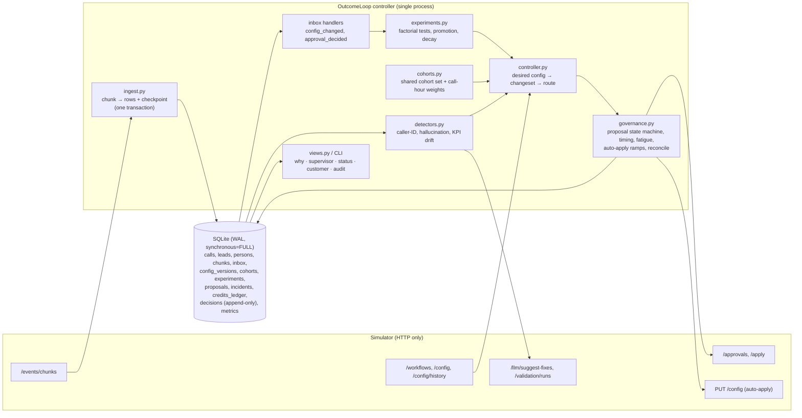
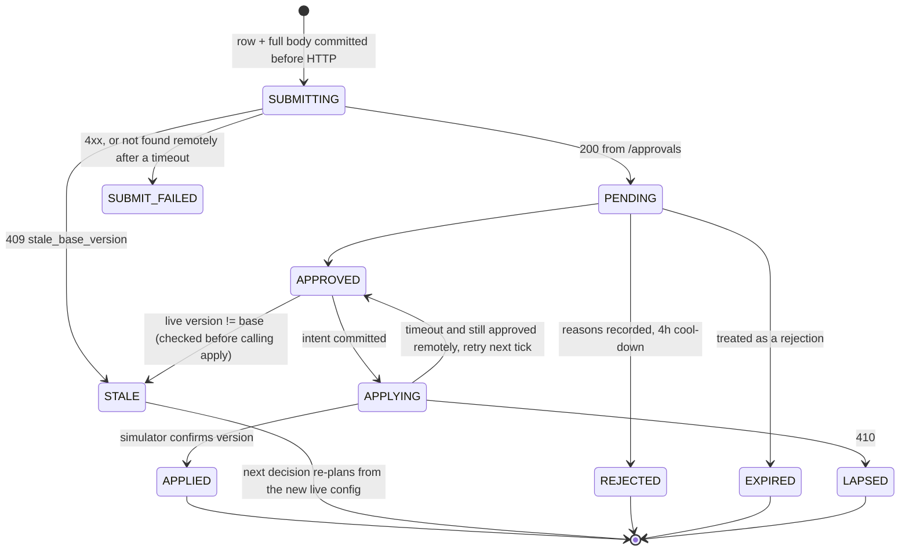

# Outcome-First Agent Loop — Submission (OutcomeLoop)

**Name:** NIRANJAN C N · **Date:** 2026-11-07 · **Hours actually spent :** 14.5 ·
**Language / storage:** Python 3.12 (stdlib + `httpx`, `numpy`) / SQLite (WAL, embedded file — no service)

> Repository map: controller in `src/outcomeloop/`, entry point `./run.sh <SIM_URL>`, grade reports and load /
> crash evidence in `reports/`, design detail in `docs/DESIGN_DECISIONS.md`, runbook in `docs/OPERATIONS.md`.

---

## 0. TL;DR

- OutcomeLoop is a single-process controller that ingests every event exactly once into SQLite, keeps one
  shared cohort object per workflow, detects caller-ID and hallucination incidents on populations, runs
  factorial welcome × voice experiments with a sequential test that controls the false-winner rate, and routes
  every change through governance with one batched proposal per workflow.
- **public_01:** conclusion rate +12.5% vs the no-op baseline (primary KPI: nw_renewal -0.1%, nw_kyc +7.5%, ks_cancel +2.8%), 0 harmful of 25 applied changes.
- **public_02:** conclusion rate +24.6%; spam-flagged caller ID moved off within ~2 h by policy-permitted
  auto-apply; supervisor's unsafe prompt reverted through an approval with validation evidence (MTTR
  105 min); 3 harmful of 28 applied.
- Kill -9 at any point and it resumes (9 hard kills on public_02; verification PASS: 20 checks, 0 failed); public_03 load: 40,806 events/s ingest, 42–53 s of controller time per simulated day for 12 workflows, 1046 MB peak memory.
- Out of sample: six scenarios of our own (different truth, policies, incidents, incl. one with **no true effects**)
  × 2 seeds plus both public scenarios — 16/16 runs finished with run.sh exit 0; conclusion rate +9.0% to +25.7% vs baseline; 0 false winners in 16 experiments on the no-effects scenario (§11).
- Deliberately not built: LLM-driven anything beyond fix suggestions, fair-share across
  tenants (C15), a UI (the supervisor view is a CLI over the same store).

## 1. Assumptions

1. **Guardrail `*_max_drop: 0.02`** is an *absolute* drop in the guardrail rate versus the concurrent incumbent
   arm (pickup 0.30 → 0.28 breaches). At public rates the absolute reading binds: 2 pp is 6–7 % of pickup (0.28–0.34) and
   3–4 % of engagement (0.50–0.60).
2. **All governance parameters are read at runtime from `GET /workflows/{id}`**: `approver_hours`,
   `approver_latency_minutes`, `proposal_ttl_hours`, `apply_window_hours`, `max_requests_per_24h`,
   `auto_apply`, `min_validation_pass_rate`. Nothing is hard-coded. Hours quoted in memos are cross-checked
   against the API, never used in place of it.
3. **Approver hours are `[start, end)` IST.** We time submissions against the *worst-case* latency
   (`next_working(now + latency_max)` must fall before `expires_at`), never the mean.
4. **Welcome message and voice are heard only after connect**, so they can only move engagement. We still
   measure pickup per arm as a guardrail. Randomisation is per dial, so a pickup gap between arms would show a
   bug or leakage, not a real effect.
5. **`welcome_message`, `voice` and `caller_id` are sampled independently per dial** (SIMULATOR §3). That is
   what makes a factorial, marginal analysis valid. Before promoting a winner we check it still beats the incumbent within the other dimension's dominant option (`_interaction`); a full welcome × voice interaction model is not fitted (§13).
6. **An approval cannot be withdrawn.** There is no cancel endpoint. Two open proposals on one workflow would
   race (the second goes `stale_base_version` on apply), so we keep **one open proposal per workflow** and
   batch new changes into the next changeset.
7. **A request over `max_requests_per_24h` is rejected, not refused**, and we assume it still uses up a slot.
   We count expired and rejected requests against the trailing-24h budget and never knowingly submit over it.
8. **`hallucination_flag` is a noisy detector** with false positives and false negatives. We act on flag
   *rates* (≥ 250 connected calls, > 1.5× baseline, z > 3.5), never on single flags. The flag rate is not
   the true hallucination rate.
9. **Validation `pass_rate` measures safety only.** It is noisy (SE ≈ 1 pp at 0.97 with n = 300) and says
   nothing about engagement. A prompt that passes validation still gets engagement verified after it is
   applied.
10. **`history_days` data reflects the business default config only.** It gives baselines, hour-of-day
    profiles and per-DID pickup. It gives no evidence on non-default variants, so dry runs for untried
    variants carry the test design (arms, planned n, achievable MDE) instead of an extrapolated lift.
11. **Returning people keep their `person_id`** across campaigns, and their features don't change; `lead_id`
    is per campaign. Per-person counts are keyed on `person_id`, and campaign membership on `lead_id`.
12. **Credits are one pool per scenario** (`GET /sim/state` → `credits_remaining`, 200 in public scenarios),
    shared by all workflows and tenants. 40 % is held as an incident reserve that routine work cannot spend.
13. **Tenant preferences we adopt voluntarily are stricter than policy.** For Kestrel (`ks_cancel`): ≤ 2
    requests/24h (policy 4) and nothing submitted before 11:00 (policy `approver_hours [10, 19]`). One slot
    per workflow is held for incidents, which leaves Kestrel and `nw_kyc` (policy 2) one routine request a day.
14. **Supervisor edits are legitimate and authoritative.** A `config_changed` event with `actor: supervisor`
    becomes the new base. For 48 h, routine changesets drop any patch to a dimension the supervisor touched. We
    only revert a supervisor edit for safety, through an approval that says so and carries validation evidence.
15. **Customer-facing dims** are `welcome_message`, `voice`, `prompt_version`, plus `cohorts` (which change who
    hears what). **Operational dims** are `caller_id` and `schedule`. No public policy permits auto-applying
    `cohorts` or `prompt_version`, so creating a cohort always needs one approval.
16. **`max_shift` is the total-variation distance per cohort per agent dimension per change** (welcome, voice,
    caller_id). The contract puts no shift cap on `schedule`. We bound hour weights to [0.25, 4] and never use
    0, because 0 can strand capacity.
17. **`mid_flight: next_campaign_only`** (`nw_kyc`) fixes cohorts and allocations per campaign when the campaign
    is created. With cadence `[2, 2, 3]`, an allocation change reaches all `nw_kyc` traffic only after three
    campaign days. Analysis uses each call's own `config_version`, not the current config.
18. **The business owns cadence, dialling windows and capacity.** `schedule.hour_weights` only changes *who* is
    dialled in an hour, never how many are dialled.
19. **"Named human approval"** (Northwind) maps to the simulator's `approval_id` + `decided_at`. The API gives no
    approver identity. In production we would record the approver's name from the client's approval system.
20. **Time zone is IST (+05:30) throughout.** That covers dialling windows, approver hours and Kestrel's 11:00.
    D0 = `2027-01-04T00:00+05:30`.
21. **Grader box is 4 vCPU / 8 GB Linux.** One single-threaded process, Python stdlib plus the pinned
    requirements. The simulator only moves on `POST /sim/advance`, so concurrency would buy nothing.
22. **SQLite (WAL, `synchronous=FULL`) is acceptable as the embedded store for the assignment.** It is a file,
    not a service. In production the same plain-SQL repository layer targets the platform's existing
    Postgres.

## 2. Scope decisions

| # | Capability | Built / Partial / Cut | Why | What it would take to finish |
|---|---|---|---|---|
| C1 | Event ingestion at load scale | **Built** | Everything else is only as good as ingestion; exactly-once is the basis of crash safety. One transaction per chunk (rows + checkpoint), `INSERT OR IGNORE` on the event key. | Rollup tables at ingest so decisions don't scan raw rows at 10×. |
| C2 | Lead/feature joins, one shared cohort object | **Built** | Product's hard requirement; features are joined onto every call row at ingest, cohort membership has one SQL implementation used by detection, experiments and the supervisor view, and it is mirrored 1:1 into `config.cohorts`. | Slice-based refinement of the cohort set (e.g. add `lang=ta`) via proposal. |
| C3 | Bootstrapping from history | **Built** | History is the only evidence on D0: hour-of-day profiles, per-number pickup, QA flag baseline, cohort choice (likelihood-ratio test). | — |
| C4 | Call-time optimisation | **Built** (cohort weights; per-person as a randomised experiment) | Cohort-level hour weights from smoothed history, dry-run estimated. Per-person preferred hours run as a self-terminating randomised experiment (treatment vs control people, pickup per dial), only where `schedule` is auto-appliable; it is kept only on evidence. | Extend per-person evidence to people returning from older campaigns. |
| C5 | Caller-ID health | **Built** | Clearest outcome lever on pickup and a named incident type; randomisation makes it measurable. Fast/slow windows, equal split over healthy numbers, rest + re-probe, ramped auto-apply. | Load-aware model (pickup vs per-number volume) for planned rotation. |
| C6 | Variant experimentation | **Built** | The core of "earning autonomy": factorial design, planned n, O'Brien-Fleming α spending, Holm, guardrail, cohort harm check. | Interaction check before promoting a combination. |
| C7 | Winner promotion, decay, rollback | **Built** | Holdout-based decay test against the promotion's lower confidence bound; rollback via approval; blacklist. | Faster decay detection with a CUSUM on the holdout lift. |
| C8 | Hallucination incident response | **Built** | Safety in a regulated business; validation probe on supervisor edits, two-signal confirmation, known-good first then LLM, engagement-verified fix. | Prompt A/B is impossible (one prompt per workflow); a staged before/after design would be next. |
| C9 | Governance client | **Built** | The non-negotiable boundary: state machine, batching, approver-hours timing with worst-case latency, fatigue with incident reserve, expiry = re-plan, stale = re-plan, auto-apply within policy and ramps. | Approver-attention budget shared across a tenant's workflows. |
| C10 | Impact scores, affected leads, dry runs | **Built** (honest, simple) | Every proposal carries all four with their basis; dry runs replay our own calls and state their bias. | Calibrate impact score against realised lift. |
| C11 | Supervisor view | **Built** (CLI + read-only HTTP) | `python -m outcomeloop supervisor <wf>` and `serve-views` (`/supervisor/<wf>`): tested / winning / waiting for you / changed today / incidents, from the same store as everything else. | A weekly summary for Compliance generated from the decision log. |
| C12 | Queryable audit store | **Built** | `decisions` is append-only (DB triggers); `why <wf> --at <t>` and `customer <person>` answer the review's question from our store. | — |
| C13 | Crash recovery, demonstrated | **Built** | SRE's non-negotiable; `scripts/crash_recovery.sh` kills with SIGKILL/TerminateProcess at several points and verifies. | — |
| C14 | Observability of the loop | **Partial** | `metrics` table (ingest events/s, lag, per-tick decide/advance time, credits, open proposals, memory), `status`, and `alerts`, which evaluates the paging rules of §10 from the store and exits non-zero when one fires (cron/pager-ready). | Export to the platform's metrics stack; wire `alerts` to the pager. |
| C15 | Fair credits / attention across tenants | **Cut** | Public scenarios use ~0–10 % of credits; fatigue is per workflow already. Building fair-share without contention data would be guesswork. | Per-tenant credit and request budgets with priority by impact score. |

**Principle.** Build whatever the hidden-scenario score and the governance boundary can't do without (ingestion,
governance, statistical experimentation, the two incident types, crash safety, audit) properly and with tests;
make the rest honest and minimal; cut what needs data we don't have. Every "Partial" is a usable slice, not a
stub.


## 3. Stakeholders

### 01 — Nikhil Rao, VP Sales

- **Accepted.**
  - Show a lift figure per workflow: the primary KPI versus baseline with its confidence interval, and the
    guardrail beside it. Source: `sim grade` reports and our audit store. (public_01 conclusion rate +12.5%, public_02 +24.6% vs the no-op baseline; per workflow in §11)
  - Fewer, bigger requests: one open proposal per workflow carries the whole batched changeset (proposal state
    machine, §6).
  - Speed where the policy allows it: caller-ID rotation and schedule changes auto-apply on `nw_renewal`
    (`max_shift 0.5`) and `ks_cancel` (`max_shift 0.2`) without waiting for an approver.
- **Pushed back / declined.**
  - **No blended score**, for a client or in a deck. The README and Product both forbid it.
  - **"Winning by lunch, live by evening" is declined.** Sample size, approver latency and `mid_flight`
    rules make it impossible (below). Promoting early is how false winners ship.
  - **Approvals stay.** We cut how *often* we ask, not *whether* we ask.
  - **No "persuasive" prompt rollout** without per-workflow validation and an engagement test.
- **Claims that are wrong against the actual policy/contract.**
  - *"Kestrel turned on auto-apply for everything."* False. `ks_cancel` has
    `auto_apply.allowed_dims = [schedule, caller_id, welcome_message, voice]` and `max_shift 0.2`.
    `prompt_version` and `cohorts` are not auto-appliable. Even for allowed dims, moving a winner from 0 % to
    85 % takes at least 5 separate auto-applies (0.2 TV each). Kestrel's supervisor has also asked to be told
    before customer-facing changes, so we send welcome and voice through approval anyway.
  - *"Northwind is fine with auto-apply on KYC."* False. `nw_kyc` has `auto_apply.enabled = false`,
    `allowed_dims = []`, `max_shift 0`, so every change needs approval, including timing and caller ID.
    Northwind's Head of Compliance requires a named human approval for anything customer-facing. A QBR remark
    doesn't change the signed policy.
  - *"Roll out the persuasive prompt wherever it's available."* The catalog describes P4 as "Persuasive: freer
    objection handling and richer benefit explanations". P4 is only an option on `nw_renewal` and
    `ks_cancel`; `nw_kyc` offers only `[P1, P3]`.
    - Prompt changes are never auto-appliable anywhere. Approval requires a validation run for *that workflow
      and prompt* with `pass_rate ≥ min_validation_pass_rate` (0.97).
    - Another account's demo is not evidence. Product's rules are that evidence comes only from what ran, and
      that winners stay in their own workflow.
    - "Freer … richer benefit explanations" is the profile most likely to hallucinate benefit claims in BFSI.
  - *"Single blended score / one figure per client."* This contradicts README §1 and Product. Even "one figure
    per client" would blend KPIs, because Northwind's two workflows have different primaries: `nw_renewal`
    optimises engagement, `nw_kyc` optimises pickup.
  - *"Winning by lunch, live by evening."* Three things rule it out.
    - **Sample size.** At MDE 10 % relative, α 0.05 family-wise, power 0.8, an engagement test at ~0.55 needs
      ~850–1,300 connected calls per challenger. `nw_renewal` produces ~1,080 connected calls a day in total
      (300 dials/h × 12 h × ~0.30 pickup). A two-challenger test at 20 % each needs 4–6 days.
    - **Approver latency.** `nw_kyc` approvers take 60–480 min within 10:00–18:00, so a noon request can be
      decided the next day.
    - **`nw_kyc` is `mid_flight: next_campaign_only`.** An approved allocation reaches only campaigns created
      from the next 08:00 batch, and all traffic only after 3 campaign days.
- **The reply you'd send them.**

  > Nikhil, I can give you an honest per-workflow lift number for the summit, with the guardrail next to it. I
  > can't give you a blended score: pickup and engagement are separate KPIs by product rule. Two facts to
  > correct. Kestrel's policy allows auto-apply only for timing, caller ID, welcome and voice, in steps of 20 %;
  > prompts always need approval. Northwind KYC has auto-apply disabled entirely. "Winning by lunch" is noise:
  > a real winner needs 2–5 days of calls on these volumes. The persuasive prompt isn't offered on KYC and must
  > pass validation per workflow before anyone sees it. The story I can stand behind: "it improved itself, and
  > the client signed off on every change."

### 02 — Meera Iyer, Head of Compliance, Northwind Life

- **Accepted.**
  1. *No customer-facing change without approval.* Welcome, voice, prompt and cohort changes on `nw_renewal`
     and `nw_kyc` go only through `/approvals` (proposal state machine). We never use auto-apply for them.
     On `nw_renewal` we auto-apply only `caller_id` and `schedule`, as the policy allows, and list each one with
     its reason in the supervisor view (`python -m outcomeloop supervisor`) and the weekly summary.
  2. *Script changes need validation evidence.* Every prompt proposal carries `evidence.validation_run_id` for
     that workflow and prompt, with `pass_rate ≥ 0.97`, and the approver enforces it too. After applying, we
     check the hallucination flag rate and engagement.
  3. *"Why did this customer hear this?"* Every call row stores the `variant` it was dialled with,
     `config_version` and `cohort_id`. `python -m outcomeloop why <wf> --at <time>` joins the config version to
     its proposal, approval, evidence and what happened next. That answers in minutes, well inside 24 h.
  4. *Slow and right.*
     - Challenger traffic is capped at 40 %.
     - A challenger significantly worse than the incumbent (z < −1.645, ≥ 200 connected) is dropped.
     - The **cohort harm check** keeps the incumbent in any cohort where the winner is worse.
     - Every promotion keeps a 15 % holdout so decay is detected.
  5. *Approver hours.* The policy matches her memo: `nw_renewal [10, 19]`, `nw_kyc [10, 18]`. We submit only
     when the worst-case decision time falls inside approver hours and before expiry. Nothing is sent at night.
- **Pushed back / declined.**
  - *"Even briefly."* An experiment exposes some customers to a challenger by definition. We can bound the
    exposure and stop early on harm, but we can't promise zero exposure.
  - *Named approval.* Our approval channel records an approval ID and timestamp, not a person. We need
    Northwind's approver identity passed through to log a name.
  - *Caller-ID rotation on renewal.* We will rotate a degraded number without asking first, as the policy
    allows. A flagged number hurts pickup for every customer, so waiting is the riskier choice.
- **Claims that are wrong against the actual policy/contract.**
  - *"Call timing and caller-ID rotation are covered by the policy we signed."* True for `nw_renewal`:
    `auto_apply.enabled = true`, `allowed_dims = [schedule, caller_id]`, `max_shift 0.5`. **False for
    `nw_kyc`:** `auto_apply.enabled = false`, `allowed_dims = []`. On KYC even a caller-ID rotation or a timing
    change needs an approval. With `max_requests_per_24h 2` and latency 60–480 min, fixing a degraded KYC
    number can take most of a working day.
  - Even on renewal, `cohorts` is not auto-appliable. Timing *per cohort* needs one approval to create the
    cohorts; after that, adjusting hour weights is covered by the policy.
- **The reply you'd send them.**

  > Meera, we accept all five conditions. Opening line, voice and script changes go through your approvers
  > only, never auto-apply. Script changes carry a validation run of at least 97 %. Every call records the
  > variant and config version it ran under, linked to the approval and the reason, so an auditor's question
  > takes minutes. One correction: your policy lets us adjust timing and caller ID automatically on Renewal,
  > not on KYC. KYC has auto-apply disabled, so we'll ask there too. We don't send requests outside 10:00–19:00
  > (KYC 18:00). Exposure in a test is capped and stopped early on harm, not zero. Please let approvals record
  > the approver's name.

### 03 — Kabir Menon, Platform & SRE

- **Accepted.**
  - *Kill/restart test.* There is a scripted kill at random points mid-run, a restart, and a check that the run
    finishes correctly with no double-apply. (PASS: 20 checks, 0 failed `reports/crash_recovery.md`)
  - *Idempotency.*
    - Each chunk's rows and its checkpoint commit in one transaction, with `INSERT OR IGNORE` on the event key.
    - Proposal rows, with their deterministic `proposal_id` and full body, are committed *before* the HTTP
      call.
    - On restart we reconcile against `GET /approvals` and `/config/history` before any retry. A timeout is
      never treated as a failure.
  - *Actionable alerts.*
    - **Page on:** ingest stalled, credits approaching the incident reserve, an approval approved but unapplied after 60 min
      (apply window 2 h), a crash loop. Each message names the workflow and the decision row.
    - **Don't page on:** KPI drift and caller-ID degradation; these go to the supervisor view.
  - *Loop health without logs.* The `metrics` table records ingest lag, events/s, decisions per hour, credit
    burn and backlog, readable from the CLI. (`python -m outcomeloop status`)
  - *< 10 min per simulated day on `public_03_load`.* Our share is 42–53 s per simulated day (`reports/public_03.md`).
  - *Breaks at 10×.* Per-tick decision queries over raw rows first, then the single writer (§8).
- **Pushed back / declined.**
  - *Redis is not used.* There is no queue or cache to share in a single-process loop.
  - *"The clock doesn't wait" is only partly met.* The loop is synchronous because the simulator pauses for
    it. In production, ingestion has to be decoupled from decision-making. We describe how, but haven't built
    it.
- **Claims that are wrong against the actual policy/contract.**
  - None. One note: the 21:30 deploy falls outside every dialling window (`[9, 21]`, `[10, 20]`), so the kill
    test that matters is mid-day, mid-approval. That is the case we test.
- **The reply you'd send them.**

  > Kabir, no new stateful infrastructure: state is one SQLite file embedded in the process (WAL, fsync on
  > commit). It maps onto your existing Postgres for production, and Redis isn't needed. The kill/restart
  > evidence is in the repo: random kills mid-ingest and mid-approval, resume, no double-apply, no lost
  > approvals. Idempotency comes from transactional checkpoints and proposal IDs persisted before any call.
  > Pages fire only for stalled ingest, credits near the incident reserve, an approval about to lapse, or a
  > crash loop. KPI drift waits for morning. Load numbers and the 10× breakpoint:
  > ingest 40,806 events/s, 42–53 s of controller time per simulated day, 1046 MB peak memory.

### 04 — Anita Desai, Operations Supervisor, Kestrel Finance

- **Accepted.**
  - *Two requests a day, not before 11:00.* Adopted, although policy allows 4/24h with `approver_hours
    [10, 19]`. One slot is held for incidents.
  - *Five things in one request.* Changes are batched into one changeset per workflow.
  - *One screen.* `python -m outcomeloop supervisor` shows what's being tested, what's winning, what we need
    from her, and what changed today and why. It uses the same cohort IDs as the experiments.
  - *Tell me before anything changes on a running campaign.* `ks_cancel` is `mid_flight: allowed`, so every
    change hits running campaigns from the next tick. Policy would let us auto-apply welcome and voice
    (`max_shift 0.2`). We don't: every customer-facing change goes through her approval.
  - *Compliance-script story.* A low-hallucination prompt can still kill engagement, because validation
    measures safety only. After any prompt change we verify engagement against the guardrail and reopen if it
    drops.
- **Pushed back / declined.**
  - *"Don't undo my changes."* We never revert silently. But a supervisor's prompt edit bypasses validation,
    and public_02 includes a supervisor prompt edit on `ks_cancel` (catalog: "adds payment-urgency language and
    benefit claims") that leads to a hallucination incident. Then we send her an approval request to revert,
    with validation evidence and the flag-rate data. She decides.
  - *Operational changes aren't pre-announced.* Caller-ID rotation and schedule auto-apply within policy and
    appear in "changed today" with the reason. A spam-flagged number shouldn't wait for an 11:00 slot.
  - *Cost of her limits.* Two requests a day, one held for incidents, leaves one routine request a day, so
    experiments on her line run slower.
- **Claims that are wrong against the actual policy/contract.**
  - None are false, but her expectations are stricter than the policy. The signed policy permits 4
    requests/24h from 10:00. It also permits auto-applying welcome and voice changes on running campaigns
    without telling her first. We follow her rules voluntarily.
  - Her prompt edits aren't held to the validation bar (≥ 0.97) that our prompt changes must clear.
- **The reply you'd send them.**

  > Anita, agreed: at most two requests a day, none before 11:00, everything batched. Your screen shows
  > what's being tested, what's winning, what we need from you, and what changed today. We won't touch your
  > prompt edits behind your back. If one triggers a spike in hallucination flags, you'll get a revert request
  > with the validation evidence, and you decide. Anything a customer hears goes through you first. Caller-ID
  > and timing changes apply within your policy and appear on the screen with the reason. After any script
  > change we check that callers still stay on the call, not just that nobody hallucinated.

### 05 — Tara Kulkarni, Head of Product

- **Accepted.**
  - *Separate KPIs.* Every experiment has a primary metric and a guardrail. Neither is blended, in reports or
    in the supervisor view.
  - *One cohort object.* The `cohorts` table is mirrored 1:1 into `config.cohorts`. We assert on ingest that
    the simulator's `cohort_id` agrees. Feature slices are candidates only and are never shown as cohorts.
  - *Minimum cohort size and window.*
    - Choices: **10 % share of dials**, **max 6 cohorts**, **MDE 10 % relative**, **α 0.05 family-wise** (Holm
      across challengers), **power 0.8**, **max 5 days**, then "no evidence, no change".
    - Sizes this gives: ~1,600–2,000 connected per arm at engagement ~0.55, or ~1,300–1,600 at 0.60.
    - Cost in speed: a real 4 % effect is detected only ~30 % of the time, and the 5-day cap retires some real
      winners unproven.
    - Cost in false winners: per dimension-experiment, at most a 5 % chance of promoting a non-winner.
    - Halving the MDE would roughly quadruple test length.
  - *Impact score.* A conservative (lower-bound) expected relative lift on the primary KPI × share of the
    workflow's dials affected, clipped to [0, 1]. The queue order is therefore expected concluded leads, not
    novelty.
  - *Diff, affected leads, dry run.* Every approval request carries them. The dry run states its limits (for
    example, schedule replay ignores pool depletion).
  - *Expired = rejected.* We re-plan from fresh data with a new `proposal_id` and never resubmit the old body.
  - *Evidence only from what ran.* Stats come from each call's actual `variant`, under config versions that
    belong to the experiment. An arm that never ran has n = 0.
  - *Winners stay local.* Winners update only their own workflow.
  - *Wishlist.* Built: caller-ID health (C5) and the consolidated supervisor view (C11).
- **Pushed back / declined.**
  - **Per-person call time is not rolled out blindly**; cohort-level call time (`hour_weights` per cohort) is the
    default, and per-person preferred hours run as a randomised, self-terminating experiment (`persontime.py`).
    - Per-person evidence is a handful of dials at ~30 % pickup, so a person's "best hour" is mostly noise.
    - `lead_preferred_hour` multiplies weight by 6 in the chosen hour but by **0.25 in every other hour**, so a
      wrong guess actively pushes the person out of hours that worked.
    - So treated and control people are compared on pickup per dial; the feature stays only on evidence and only
      where `schedule` is auto-appliable (ablation over 16 runs: +0.93 pp, `reports/ablation_person_time.md`).
  - *Rank the queue by impact score.* Accepted, but with one open proposal per workflow, ranking applies
    across workflows, not within one.
- **Claims that are wrong against the actual policy/contract.**
  - None against the contract. Two nuances:
    - The simulator does distinguish `expired` from `rejected`. We treat both as rejection for planning but
      record which it was, and an expired request still counted against the 24 h request budget.
    - The API requires diff, affected leads and dry run only on approvals, not on auto-apply. We compute and
      store them for auto-applies too, so the surface is consistent.
- **The reply you'd send them.**

  > Tara, all seven definitions are in. On the open questions: cohorts need at least 10 % of dials,
  > with at most six per workflow. Tests are sized for a 10 % relative lift at 5 % family-wise error and 80 %
  > power, capped at 5 days. The cost: effects under ~5 % mostly go undetected, and some real winners expire
  > unproven. In exchange, false winners stay rare. The impact score is a conservative expected lift × share
  > affected, so ranking by it is meaningful. Caller-ID health and the supervisor view are built. Per-person
  > call time runs as a randomised experiment, not a rollout: a handful of dials per person rarely picks a best
  > hour, and the 0.25× penalty punishes wrong guesses, so it stays only where treated people out-pick controls.
  > Cohort-level timing is the default.

### 06 — Aryamann, CTO

- **Accepted.**
  - *Explainable beats bigger.* Every decision, no-ops included, is a row in the append-only `decisions`
    table. `python -m outcomeloop why <wf> --at <time>` answers "who, why, what next". Customer-facing changes
    always go through approval.
  - *Hurting a cohort is worth less than nothing.* The cohort harm check runs before promotion, harm stopping
    applies during tests, and holdout-based decay detection (15 % holdout) catches winners that stop winning.
  - *No compute that doesn't change a decision.*
    - Incident fixes try our own last known-good prompt before calling `suggest-fixes`.
    - Validation runs at n = 300 (3 credits).
    - An LLM never chooses a winner.
    - 40 % of credits is an incident reserve. Credits used: 3 on public_01, 6 on public_02, of 200.
  - *Scale.* Transactional, idempotent chunk ingestion. `ingest 40,806 events/s, 42–53 s of controller time per simulated day, 1046 MB peak memory` We state what
    breaks first at 10× and how we'd partition by tenant and workflow.
  - *Choosing.* Per-person call time ships as an experiment rather than a rollout; the cuts in §2 each have a
    drafted message.
  - *Own it next month.* There is a runbook for each page and a restart procedure. (`docs/OPERATIONS.md`)
  - *Trust the contract.* Each memo claim was checked against `GET /workflows` policy; the false ones are
    listed above.
- **Pushed back / declined.**
  - *"Hundreds of workflows without an engineer"* is limited by approvers, not compute: 2–4 requests per
    workflow per day, minus our own reserve. Autonomy at scale comes from batching and auto-apply where policy
    allows.
  - The cohort harm check covers the cohorts we define, not every possible feature slice. A harm that is
    confined to an undefined slice can still slip through.
- **Claims that are wrong against the actual policy/contract.**
  - None in this memo. As he predicted, wrong claims appear in Sales (Kestrel and KYC auto-apply, P4),
    Compliance (KYC timing and caller ID) and, by omission, Kestrel (expectations beyond the policy).
- **The reply you'd send them.**

  > Aryamann, I chose depth over breadth: governance, experiments with cohort harm checks and decay rollback,
  > caller-ID health, hallucination response, and a full audit trail. Per-person call time runs as an experiment, and the cuts
  > are listed with reasons and drafted messages to the people affected. Every change on a client agent can be
  > explained from our own store in one command. Credits go first to known-good fixes, and 40 % is reserved for
  > incidents. On scale: ingest 40,806 events/s, 42–53 s of controller time per simulated day, 1046 MB peak memory. The first bottleneck at 10× isn't compute but
  > approver capacity at 2–4 requests per workflow per day. I've designed around that with batching. Three
  > memos contained claims the policies contradict; I followed the policies.

## 4. Architecture

One process, one SQLite file, one synchronous loop. The simulator only moves when we call `/sim/advance`, so
concurrency would buy nothing; determinism and crash-safety buy a lot. Every box below is a module in
`src/outcomeloop/`.



**Per 15-minute tick:** governance tick (poll open approvals; apply approved ones after checking the base is
still current) → hourly (or immediately after a supervisor prompt edit) a decision per workflow → advance →
ingest new chunks → handle inbox events → record loop metrics.

**Decision per workflow** (`Controller.decide`): caller-ID health → hallucination check → (12:00) KPI drift
alert → experiment step (design / look / harm watch / decay check) → build the *desired* config on top of the
*live* config from our own state → diff → route (approval, auto-apply, or hold with a recorded reason).

**State.** Everything that matters is in the SQLite file: raw call rows (integer-encoded, features joined in),
leads/persons, the chunk checkpoint, our view of every config version, cohorts, experiments (full JSON state),
proposals (intent + body + remote state), incidents, credit ledger, the append-only decision log and metrics.
Nothing is held only in memory except caches rebuilt on start (feature arrays, code dictionaries).

**On restart.** (1) If the simulator is a *different world* (scenario name, or first history chunk id, or our
checkpoint is ahead of the simulator's clock) the old DB is archived and we start clean. (2) Otherwise we
ingest any chunks after our checkpoint, reconcile every proposal left in `SUBMITTING`/`APPLYING`/`AUTO_APPLYING`
against `/approvals` and `/config/history`, re-run unhandled inbox events (idempotent), and carry on. `run.sh`
itself restarts the controller if it exits abnormally.

## 5. The learning loop

### Cohorts
* **One shared object.** A cohort is `{cohort_id, where}` with the simulator's semantics; a workflow has one
  ordered cohort set, first-match, else `default`. The same set is written into `config.cohorts`, used by every
  analysis query (one SQL implementation, `membership_sql`), and shown in the supervisor view.
  `check_cohort_agreement` verifies it daily against the `cohort_id` the simulator stamps on each call (0
  mismatches across 95k calls on public_02).
* **How they're formed (C3, from history).** For each lead feature we test whether its values have different
  hour-of-day pickup profiles: binomial deviance G² of `pickup ~ hour × feature` against the additive model,
  likelihood-ratio test (p < 0.001), and pick the feature with the largest G² per degree of freedom. On all
  three public workflows this picks `age_band` (G²/df 4.6–8.2 vs ≤ 2 for the others); nothing is hard-coded,
  a hidden scenario with a different driver would get a different partition, or none.
* **Minimum size and fragmentation.** Groups under **10 % of dials** are merged with a neighbour, **max 6
  cohorts**. Reason: a cohort must be able to support a per-cohort comparison. At ~1,000 connected calls/day,
  10 % is ~100/day, so a cohort-level harm check reaches the 200-call floor in ~2 days. Smaller cohorts
  would never accumulate evidence inside a scenario. Experiments run on the `default` allocation (all cohorts
  share it) so traffic is never split by cohort unless a cohort-specific decision is made.

### Experiment design (C6)
* **Factorial.** `welcome_message` and `voice` are sampled independently per dial, so one experiment per
  dimension runs concurrently and each is analysed on *all* traffic (marginal over the other). We assume no
  welcome × voice interaction (see §13).
* **Allocation.** Incumbent keeps 60 %, challengers split 40 %. Dunnett's √k rule would give challengers
  ~60 % for maximum power; we trade some power for bounded exposure (Compliance: slow and right).
* **Sample size.** Planned n per challenger for a 10 % relative MDE at α 0.05 family-wise, power 0.8,
  at the workflow's own historical engagement, capped by what 5 days of traffic can deliver. The **achieved
  MDE** at that n is recorded on the experiment and shown in the proposal, so an under-powered test is visible
  as such. Product's question, "what does it cost": at nw_renewal volumes a 3-arm welcome test resolves a ~10 %
  lift in 2–4 days; at 5 % MDE it would need ~4× the data, beyond a 10-day scenario.
* **Exploration vs exploitation.** Explore at a fixed 40 % until a pre-registered rule decides, then exploit
  (85 % winner, 15 % holdout). Hourly harm watch: any challenger significantly worse (z < −2.33 on ≥ 200
  connected) is dropped and blacklisted for 14 days, so exploration cost is bounded early.

### Deciding a winner
* **Metric.** Experiments always decide on engagement: welcome and voice are heard only after connect, so they
  cannot move pickup. On a pickup-primary workflow (`nw_kyc`) this improves the guardrail KPI and the business
  outcome, and pickup per arm is still checked as a guardrail; the primary KPI there is moved by caller ID and
  call-hour weights.
* **Test.** One-sided two-proportion z-test on engagement (engaged ÷ connected) of each challenger vs the
  incumbent, using only calls that actually ran with that variant under the experiment's config versions
  (Product: only what happened counts).
* **Stopping rule.** Daily looks at the approver's start hour. Lan-DeMets **O'Brien-Fleming** spending
  `α(t) = 2 − 2Φ(z_{α/2}/√t)` with information fraction `t = n / n_plan`; each look's nominal level is the
  increment of spent α, and α is tracked as an **explicit budget** on the experiment, so the family-wise
  false-winner rate stays ≤ 0.05 across looks (Bonferroni over looks, conservative). At the horizon, if
  the best challenger trends positive, a single **pre-registered extension** doubles the horizon (half of
  the remaining α is reserved for it at the first horizon).
* **Multiple comparisons.** Each look's α is split: 80 % to Holm step-down across challengers, 20 % to the
  cohort-level family (found by our own audit: testing both families at the full α allowed up to 2α). Cohort-specific winners
  (when there is no pooled winner) use Bonferroni across cohorts on top.
* **Before promoting:** guardrail check (below); **cohort harm check**: any cohort where the winner is worse at
  z < −1.645 keeps the incumbent via a per-cohort allocation; **stability check**: the last-24h lift must not be
  ≤ 0 or significantly below the whole-window lift (guards against promoting an effect that is already wearing
  off). Ties: highest 80 % lower confidence bound, then option order. No randomness anywhere in decisions.
* **Fresh at apply time.** A promotion waiting on governance (approver latency, a stale base after a supervisor
  edit, a rejection) is re-checked every tick and **withdrawn** if its effect has faded; the test continues. Our
  strict-policy scenario showed a winner decided at D4 and applied 30 h later, after it had decayed.
* **False-winner rate.** ≤ 5 % per (workflow, dimension) by construction (Holm × spending budget). Evidence from
  the runs: winners promoted on public_01/02 are listed in §11 with the grader's verdict.

### Decay and rollback (C7)
* After promotion, the previous incumbent keeps a **15 % holdout**, giving a concurrent control.
* Hourly, over the last 24 h (widened to 48 h / 72 h until the holdout has ≥ 120 connected calls — a 15 % holdout
  on a small workflow collects ~100 a day), we test the winner-vs-holdout lift against the **80 % lower confidence bound of
  the lift measured at promotion** (not its point estimate: the estimate taken at the moment a test first
  crosses a boundary is biased upward, the winner's curse; our first version rolled back a genuine winner for
  exactly this reason). Rollback when `z < −2.33`, or when the recent lift is itself negative at `z < −2.33` (both
  at the 1 % level because the check repeats hourly over overlapping windows; at 5 % our suite showed false
  rollbacks of genuine winners). Under `next_campaign_only`, calls from older campaigns still running the experiment
  allocation count: they are concurrent, randomised comparisons of the same arms.
* Rollback = proposal back to the holdout option; the decayed option is blacklisted for 7 days.
* How fast: the share of in-population calls still on the decaying `W3` after its decay onset, by simulated day,
  from the grader (grader: share by day after onset {"2": 0.192, "3": 0.734, "4": 0.429, "5": 0.0, "6": 0.0, "7": 0.0, "8": 0.0, "9": 0.0}) — typically 2–4 days from onset to 0 %. The limit is power: a 15 % holdout gets ~150 connected calls/day on nw_renewal.

### Call time and caller ID (C4, C5)
* **History (C3).** 14 days (7 on load) of calls under the business default give per-cohort hour-of-day pickup
  profiles. Weights: `(p̂(cohort,h)/p̄(cohort))²`, empirical-Bayes-smoothed toward the workflow hour profile with
  200 pseudo-dials, clipped to [0.25, 4]. Never 0: a 0 strands capacity when every eligible lead has weight 0.
  Dry run: historical re-weighting at fixed per-hour dial volume (+1.5–1.8 % pickup on public_01, stated as an
  upper bound because it ignores lead-pool depletion).
* **Per-person, tested rather than assumed** (`persontime.py`). A person who picked up at hour h may pick up at h
  again, but `lead_preferred_hour` multiplies weight by 0.25 outside the preferred hour, so a wrong guess hurts. We
  therefore run it as a randomised experiment: candidates are people with an active lead who connected during the
  current cadence (preferred hour = hour of their connects); a sha256 hash of `person_id` puts each in treatment
  (preference) or control (none); a daily look compares pickup per dial after each person became a candidate
  (z > 2.33 → expand to 90/10, z < −2.33 → stop and remove, no evidence by day 5 → stop). It only runs where
  `schedule` is auto-appliable by policy (the daily map refresh would otherwise spend the approval budget), and a
  stop removes only the entries we wrote. Measured result: within a single run the daily test is
  under-powered (public_01: |z| ≤ 1.04 over five looks, stopped on day 5 with "no evidence", preferences removed);
  across 16 paired runs with the feature on vs off it adds **+0.93 pp** of conclusion rate (t = 2.48;
  `reports/ablation_person_time.md`), so it stays on by default. Cost: ~10 extra auto-applied schedule refreshes
  per run, all neutral in the grader. People returning from much older campaigns are not covered.
* **Caller ID.** Per-dial randomisation means a number's pickup vs the pooled other numbers in the same window
  isolates the number. **Degraded** = ratio < 0.85 and z < −3.5 on ≥ 300 dials in a 6 h or 24 h window **and**,
  for a number with a week of its own history, a drop of > 15 % against that history (z < −3). The second
  condition separates a spam flag (a sudden drop) from volume fatigue (a steady state next to a fresh number);
  without it the controller once ramped a merely tired number out and put 100 % of traffic on one number, which
  the crash-recovery comparison exposed. **Healthy** = the ratio's ~84 % lower bound ≥ 0.85 on ≥ 150 dials
  (24 h, or 72 h so a 5 % probe on a small workflow can complete). Evidence for a re-probed number only counts
  from the start of its probe. **Target** = equal split over healthy numbers (lowest per-number volume), 0 for
  degraded, untested numbers share a probe budget of at most 10 % (5 % each); a number whose health is still unknown
  keeps the share it has (insufficient evidence never moves traffic between healthy and unknown), but a
  measured-degraded number **always** gives up its share — to numbers already carrying traffic first, otherwise to
  the untested ones (an untested number is a better bet than one measured as flagged). A degraded number rests (24 h, doubling), then gets a time-boxed
  2 % re-probe.
* **Exploration of numbers** is the probe share; it is auto-applied where policy allows (operational dim).

### Guardrail KPI
* Every challenger's guardrail KPI is compared with the incumbent's: block promotion if the point drop exceeds
  the policy margin (read as an absolute rate drop, assumption 1), or if a statistically significant drop
  (z < −1.645) exceeds half the margin.
* Workflow-level drift alerts at 12:00 daily (last 24 h vs previous 7 days, > 5 % relative and z > 3).
* For prompt fixes, engagement is verified after the change (§7).

## 6. Governance

### Proposal lifecycle (ours, `governance.py`)



`PENDING/APPROVED → WITHDRAWN` when we no longer want a change (e.g. a promotion whose effect faded while the
request waited): never applied, still counted toward fatigue. **Emergency proposals apply first**; a routine
approval waits while an emergency for the same workflow is open, so our own change cannot make the safety fix
stale.

Auto route: `AUTO_APPLYING → APPLIED | AUTO_DENIED (403) | AUTO_FAILED` — a 403 sends those dims to the approval
route for 24 h, and a dimension last set by a supervisor is approval-only until one of our approved changes to it
lands. Reconciled via
`/config/history` (which records our `proposal_id`) after a timeout.

**Re-proposal is a re-plan, not a resubmit.** Every decision computes the desired config from our state on
top of the *current live* config. A stale, expired, rejected or lapsed proposal is therefore never resent:
the next plan starts from fresh data and the new base (Product: expired = rejection).

### Batching and timing
* **One open proposal per workflow.** Approvals can't be withdrawn, so two open ones race to a stale base.
  Everything we want for a workflow is batched into one changeset: cohorts + schedule + caller IDs + experiment
  starts went out as a single request on D0.
* **When we send.** Only inside approver hours, after the tenant's preferred start (Kestrel: 11:00), and only
  if the *worst-case* decision time `next_working(now + latency_max)` falls before expiry (for an emergency — a
  flagged caller ID or an unsafe prompt — the *best-case* time is enough: an expired emergency request costs one
  slot, waiting costs customers; an emergency may also overtake a pending routine proposal). On `nw_kyc`
  (latency up to 8 h, hours 10–18) that means early in the day.
* **Fatigue.** Trailing-24h count of every request (rejected and expired count too) < `min(policy, tenant
  preference)`, with **one slot reserved for incidents**. Effect: ≤ 1 routine request/day on `ks_cancel` and
  `nw_kyc`, ≤ 2 on `nw_renewal`. Peak requests/24h on the public runs: public_01 {'nw_renewal': 1, 'nw_kyc': 1, 'ks_cancel': 1}, public_02 {'nw_renewal': 2, 'nw_kyc': 1, 'ks_cancel': 1}.
* **Apply window.** We poll every 15 simulated minutes, so an approval is applied within one tick (2 h window).
  Lapsed approvals on the public runs: 0 and 0.

### Auto-apply: when we use it and when we don't
* **Used** only for operational dims (`caller_id`, `schedule`) and only where the policy allows them, within
  `max_shift`. A bigger caller-ID move (e.g. leaving a spam-flagged number on `ks_cancel`, `max_shift 0.2`) is
  ramped in ≤ max_shift steps ≥ 1 h apart, each re-planned from fresh health data, cumulative ≤ 3×max_shift
  per day. On public_02 the flagged number went from 50 % to ~0 % in two steps (12:00, 13:00).
* **Voluntarily not used** for welcome, voice, prompt, cohorts, even where `ks_cancel` would allow welcome/voice:
  Kestrel's supervisor asked to be told before anything customer-facing changes on running campaigns
  (`mid_flight: allowed`), and Northwind's compliance requires a human approval. Cost: slower experiments on
  Kestrel (one routine request/day).

### Impact score, affected leads, dry run (how honest)
* `impact_score = clip(lift_LCB80 / 0.10, 0, 1) × (1 − holdout share)` for a promotion; pure exploration 0.15 (learning,
  no proven lift), schedule = dry-run lift halved (the dry run is an upper bound), urgent caller-ID 0.7,
  validated safety fix 0.9. Components are in `evidence.impact_detail` so the queue order is explainable.
  It is ordinal, not a forecast.
* `affected_leads` = active leads (not concluded, inside cadence) for `mid_flight: allowed`; for
  `next_campaign_only` customer-facing changes, the next campaign's size (they only reach new campaigns).
* `dry_run` replays our own recorded calls: per-arm/per-cohort observed rates (with n, z) for variants,
  historical re-weighting for schedule, per-number pickup for caller ID, validation runs + observed flag rates
  for prompts. Each dry run states its window and known bias. For an exploration (never-tried variants) the dry
  run is the test design itself — arms, planned n and the achievable MDE — not a predicted lift.

### Supervisor edits mid-experiment
`config_changed` with `actor: supervisor` → the changed dims are **locked for 48 h** (no proposals touch
them), an experiment on that dimension is **aborted** (its arms are no longer what we designed; mixing would
contaminate the comparison), other dimensions' experiments continue (independent randomisation), and any open
proposal on the old base will be found stale at apply time and re-planned without the locked dims. On public_02
(`nw_renewal`, D5 15:00, voice → V2) the voice dimension was locked, nothing of ours overwrote it, and the next
voice test 48 h later kept the supervisor's V2 as the incumbent. The one exception is safety: a supervisor's
unsafe prompt is reverted **only via an approval request that says so**, with validation evidence (§7).

## 7. Incidents

### Hallucination (C8)
* **Detection.** QA-flag rate on the live prompt (since its last change, ≤ 24 h) vs the workflow's own
  history rate; fires at rate > 1.5× reference, z > 3.5, ≥ 250 connected calls. A supervisor prompt edit also
  triggers an immediate **validation probe** of the new prompt (300 synthetic calls, 3 credits): the earliest
  population-level evidence, available before enough real calls accrue.
* **False positives.** The flag detector is noisy. Our first version opened an incident on the production
  prompt from a QA-flag tail event and swapped in a "strict" script that cut engagement 14 %. Now an
  incident from flags alone needs **a second, independent signal** unless the production signal is overwhelming
  (≥ 2× baseline, z ≥ 5 on ≥ 400 calls): we validate the live prompt, and only a *clearly* safe result — at least
  the threshold plus one standard error — vetoes the incident; a result inside the threshold's noise band gives
  the benefit of the doubt to safety. Per-look false-alarm probability ≈ 2×10⁻⁴ (z 3.5) × P(production prompt fails
  validation) ≈ 10⁻³ *(derived from the binomial at n=300)*, so a false prompt change is ~10⁻⁶ per look.
* **Choosing a fix (LLM proposes, never decides).** Candidates in order: (1) prompts with ≥ 1,000 connected
  calls in our own history and a normal flag rate, ordered by observed engagement (validation says nothing about
  engagement); (2) only if none validates, `/llm/suggest-fixes` (3 credits). Each candidate is validated
  (n = 300 while credits ≥ 60, 200 while ≥ 20, else 100 — a 100-call run still separates a 1 % from a 5 % failure
  rate, and running out mid-incident is the worse failure); the first that passes `min_validation_pass_rate` (read
  from the policy) wins. Deterministic. A probe result within one standard error of the threshold is treated as a
  coin flip: a second run is bought next tick and the decision uses the pooled sample.
* **Verification after apply.** After 4 h: flag rate back under the detector threshold **and** engagement on
  the new prompt not > 5 % below the pre-incident week (z < −2). A safe-but-disengaging fix (Kestrel memo:
  "nobody hallucinated, nobody stayed") is marked harmful and the next candidate is tried.
* **Credits.** 40 % of the starting budget is reserved for incidents; routine work cannot spend it (routine
  work currently spends nothing). Credits used: public_01 3, public_02 6 of 200.

### Caller-ID incident (C5) — see §5. Detection uses a 6 h window so a flag is visible within ~2 h of dialling.

### public_02 timeline (from our audit store, `python -m outcomeloop audit --wf ks_cancel`)
```
D2 12:00  ks_cancel    did_health               controller caller ID D2: healthy -> degraded
D2 12:00  ks_cancel    cohort_check             controller cohort agreement: 0 of 4800 calls assigned differently
D2 12:00  ks_cancel    auto_apply               controller auto-apply ['caller_id'] -> APPLIED (ramp 60% of the way)
D2 12:00  ks_cancel    config_changed           controller_auto v9 by controller_auto: caller_id
D2 13:00  ks_cancel    auto_apply               controller auto-apply ['caller_id'] -> APPLIED
D2 13:00  ks_cancel    config_changed           controller_auto v10 by controller_auto: caller_id
D3 11:30  ks_cancel    config_changed           supervisor v12 by supervisor: prompt_version
D3 11:30  ks_cancel    supervisor_edit          controller supervisor changed ['prompt_version']; locked for 48h — we will not propose changes to these dims
D3 11:45  ks_cancel    validation_run           controller validated P2: pass_rate 0.937 (n=300, 3 credits) — probe supervisor prompt change v12
D3 11:45  ks_cancel    incident_opened          controller hallucination incident on prompt P2
D3 11:45  ks_cancel    validation_run           controller validated P1: pass_rate 0.990 (n=300, 3 credits) — candidate fix for inc-ks_cancel-5025 (known_good)
D3 11:45  ks_cancel    incident_fix_selected    controller inc-ks_cancel-5025: fix = prompt P1 (known_good), validation pass 0.990 >= 0.97
D3 11:45  ks_cancel    proposal_submitted       controller ol-ks_cancel-5025-20 -> PENDING: revert unsafe prompt P2 -> P1
D3 12:00  ks_cancel    did_health               controller caller ID D2: degraded -> probe
D3 12:00  ks_cancel    cohort_check             controller cohort agreement: 0 of 4800 calls assigned differently
D3 13:15  ks_cancel    proposal_approved        controller ol-ks_cancel-5025-20: approved by client approver
D3 13:15  ks_cancel    proposal_applied         controller ol-ks_cancel-5025-20: applied
D3 13:15  ks_cancel    config_changed           controller_approved v13 by controller_approved: prompt_version
D3 13:15  ks_cancel    incident_fix_applied     controller inc-ks_cancel-5025: prompt P1 live (v13)
D3 18:00  ks_cancel    incident_verified        controller inc-ks_cancel-5025: after fix flag rate 0.0146 vs ref 0.0137 on 478 connected calls
```


## 8. Scale

Measured on `public_03_load` (12 workflows, ~840k events/day) with `scripts/load_test.sh`; full report in
`reports/public_03.md`. Windows-11-10.0.26300-SP0, 12 logical CPUs, Python 3.12.10. Measured on a 12-logical-CPU Windows 11 laptop; the simulator ran on the same machine; unrelated containers (Kafka, Postgres, Redis, MinIO, Jaeger) were running on the host. Code: commit 51965ce.

| measure | value |
|---|---|
| history backlog ingested before D0 | 5,537,379 in 127.1s → 43,550 events/s |
| live ingest (D0–end) | 4,200,187 in 102.9s → 40,806 events/s |
| controller time per simulated day (ingest + decide, 12 workflows) | 42–53 s (SRE target < 600 s) |
| simulator time per simulated day (world generation, not ours) | 16–20 s |
| wall clock per simulated day, both together | 64–70 s |
| controller time per 15-min tick, p50 / p95 / max | 0.43s / 1.14s / 17.84s |
| peak controller memory | 1046 MB |
| SQLite at end (7 days history + 5 days, every call row kept) | 433 MB for 7,433,295 call rows |

**Decision lag.** In simulated time a detector sees an event at most 15 min (one tick) after it happens and
decides at most 60 min later (hourly cadence); a supervisor prompt edit triggers a decision on the next tick.
In wall-clock time the controller's own work per 15-minute tick is 0.43s / 1.14s / 17.84s (ingest + all decisions for
12 workflows); against a real dialler that is the end-to-end lag added by us.

**SRE's target** (one simulated day in < 10 wall-clock minutes on 4 vCPU / 8 GB): our share is
42–53 s per simulated day on a laptop; the rest of the wall time is the simulator generating the
world. Memory stays small because analysis is SQL over an on-disk table; only per-person feature arrays
(1 int32 per person) live in RAM.

**What breaks first at 10× (≈ 8.5 M events/day, 120 workflows)** *(derived from the measurements above)*:
1. **Per-tick decision queries — measured and fixed.** Profiling public_03 showed decisions re-aggregating raw call
   rows over sliding 6–72 h windows (caller-ID health 59 % of decide time, decay checks 20 %). Hourly rollups
   (`did_hour`, `arm_hour`) are now maintained inside each chunk's ingest transaction — recomputed per touched
   workflow-hour from the call rows, so they stay exactly-once under replay — and decisions read those instead:
   decide time fell from ~52–67 s to ~8–14 s per simulated day for ~+15 % ingest time in an isolated measurement (15–27 s decide in the final load run on a busier shared host, `reports/public_03.md`). Measured scaling: 1× vs 3× public_03 in a 4 vCPU / 8 GB Linux container (`reports/scaling.md`): controller time per simulated day ~47 s → ~126 s (2.7× for 3× the events and workflows), peak memory 898 → 1,036 MB, 0 decision errors — linear, with ≈ 420 s/day projected at 10× (under the 600 s target, little headroom).
2. **One SQLite writer.** Ingest at ~50k events/s is ~3 min/day at 10× — fine — but one process serialises
   ingest and decisions. Fix: partition workflows into shards (hash of `workflow_id`), one loop + checkpoint per
   shard, on the platform's Postgres with `calls` partitioned by day.
3. **Storage.** ~61 bytes per stored call row → ~10 GB/month at 10×. Retention
   policy with Compliance; rollups kept, raw calls archived after the audit window.
4. **Credits and approver attention** become shared resources across 100+ workflows (C15, cut): per-tenant
   budgets ranked by impact score.

## 9. Reliability

* **Crash-recovery test** (`scripts/crash_recovery.sh`, report `reports/crash_recovery.md`): one run of
  public_02, the controller hard-killed **9 times** with SIGKILL / TerminateProcess at state-targeted moments —
  during history ingestion, with a proposal pending, with an approval approved-but-not-applied, mid-dial, with a
  paid validation call in flight, at the supervisor's edit, with a proposal submit in flight — and restarted
  against the same SQLite file each time. **PASS: 20 checks, 0 failed** Checks include: every chunk ingested exactly
  once (event counts equal to the simulator's), calls table equal to the simulator's call events, no proposal or
  approval applied twice, every simulator approval known to our store, nothing left in an uncertain state,
  experiments and incidents not duplicated and continuing under the same ids, credits accounted for, run finished.
  Outcomes under kills: conclusion rate +26.5% vs baseline with 9 kills vs +24.6% uninterrupted, both on the final decision logic (commit `51965ce`).
* **The test found three real defects**, all fixed: a paid validation result could be lost between the ledger
  and the incident (now one transaction); a supervisor-prompt probe was cleared before the validation call, so a
  crash forgot a pending safety check (now cleared in the same transaction as the result); and a caller-ID
  decision flaw that only showed up by comparing crashed vs clean runs (§5).
* **Graceful shutdown.** SIGTERM/SIGINT (deploys, `docker stop`) are forwarded by `run.sh` to the controller,
  which finishes the current step, records `controller_stop` and exits 143; `run.sh` restarts only on an
  *unrequested* exit. Verified in a Linux container (`scripts/graceful_stop_test.sh`): SIGTERM at D4 11:15 → clean
  stop with no proposal in an uncertain state → restart on the same DB finishes with exactly-once ingestion.
* **Events are never dropped.** A side-effect event (`config_changed`, `approval_decided`) whose handler hits a
  transient error is retried next tick; later events of that workflow wait, and the workflow gets no decisions
  until its events are processed (a lost supervisor edit would mean overwriting it). Dead-lettered with an
  audited error only after 10 attempts.
* **One controller per state file.** An exclusive OS lock on `<db>.lock` is taken before the store is opened; a
  second controller on the same state is refused (two would duplicate submissions). Released by the OS on SIGKILL.
* **Corrupted state.** `PRAGMA quick_check` at start-up; a damaged store is archived and rebuilt from the simulator
  (an approval we can no longer explain is adopted as `WITHDRAWN`, never applied).
* **Every applied change is verified 24 h later** (`post_apply_verification`: pickup and engagement before/after,
  guardrail KPI against the policy margin, alert on breach) — the audit trail always has a "what happened next".
* **Adversarial testing** (`docs/ADVERSARIAL_TESTING.md`): 32 attacks — an apply-boundary crash matrix, HTTP
  429/5xx/truncated responses, a second controller process killed with SIGKILL, a corrupted store, null-effect and
  strict-policy scenarios — each with what it found, the fix and the regression test.
* **Adversarial review.** An independent read-only audit of the code (fresh eyes, prompted to find crash-safety,
  governance, statistical and performance defects) reported 20 findings; the 3 high and 8 medium ones are fixed and
  the high ones have regression tests (e.g. a withdrawn promotion's approval was still being applied; our own
  routine approval could make an incident fix stale; the cohort-winner family re-spent the look's α).
* **What a crash loses.** Nothing durable. In flight at the instant of the kill: at most one HTTP response
  (reconciled on restart), and for a credit-spending call (no idempotency key in the API) up to 3 credits may be
  spent twice.
* **Idempotency keys.** Chunk number + `event_id` (ingestion); deterministic `proposal_id`
  (`ol-<workflow>-<sim minute>-<seq>`) committed before submit and auto-apply; `approval_id` for apply.
* **Simulator errors.** GETs retried with back-off on connection errors/5xx. Writes: a connection refused
  before sending is retried; a timeout or 5xx after sending raises `Uncertain` and is reconciled against
  `/approvals` or `/config/history` — never assumed failed. 409 `stale_base_version` → re-plan on the new base;
  410 lapsed → recorded, re-planned; 409 `duplicate_proposal_id` → reconcile (it landed earlier); 403 auto-apply →
  recorded, the change waits for the approval route; 402 credits → incident work stops spending, routine work
  never spends below the 40 % reserve. Any unexpected exception in one workflow's decision is audited and isolated;
  `run.sh` restarts the controller from durable state if the process itself dies.

## 10. Audit & observability

The review question, answered from our store only (real output, public_02, trimmed):

```
$ python -m outcomeloop --db state/public_02_incidents.db why ks_cancel --at "D3 13:15"
# why: ks_cancel at D3 13:15

Config v13 became live at D3 13:15 — actor: controller_approved, changed: ["prompt_version"]

## Proposal ol-ks_cancel-5025-20 (approval route, incident), created D3 11:45, state APPLIED
Approved by: client approver, approval apr_00007 (decided 2027-01-07T12:55:00+05:30, created 2027-01-07T11:45:00+05:30)
Summary: revert unsafe prompt P2 -> P1
Impact score: 0.9 · affected leads: 3611
Rationale: Safety incident inc-ks_cancel-5025: the live prompt is producing hallucinations above the workflow's own baseline. revert unsafe prompt P2 -> P1; val
Diff: {"prompt_version": {"after": "P1", "before": "P2"}}

## Decisions that led to it
  D0 18:00  did_health               caller ID D3: unknown -> healthy
  D0 18:00  auto_apply               auto-apply ['caller_id'] -> APPLIED (ramp 71% of the way)
  D0 19:00  auto_apply               auto-apply ['caller_id'] -> APPLIED
  D1 09:00  auto_apply               auto-apply ['schedule'] -> APPLIED
  D1 15:00  experiment_drop_arm      voice: dropping ['V4'] (significantly worse)
  D1 15:00  proposal_submitted       ol-ks_cancel-2340-12 -> PENDING: voice: running default=V1 69%,V2 15%,V3 15%
  D1 17:15  proposal_approved        ol-ks_cancel-2340-12: approved by client approver
  D2 09:00  auto_apply               auto-apply ['schedule'] -> APPLIED
  D2 12:00  did_health               caller ID D2: healthy -> degraded
  D2 12:00  auto_apply               auto-apply ['caller_id'] -> APPLIED (ramp 60% of the way)
  D2 13:00  auto_apply               auto-apply ['caller_id'] -> APPLIED
  D3 09:00  auto_apply               auto-apply ['schedule'] -> APPLIED
  D3 11:30  supervisor_edit          supervisor changed ['prompt_version']; locked for 48h — we will not propose changes to these dims
  D3 11:45  validation_run           validated P2: pass_rate 0.937 (n=300, 3 credits) — probe supervisor prompt change v12
  D3 11:45  incident_opened          hallucination incident on prompt P2
  D3 11:45  validation_run           validated P1: pass_rate 0.990 (n=300, 3 credits) — candidate fix for inc-ks_cancel-5025 (known_good)
  D3 11:45  incident_fix_selected    inc-ks_cancel-5025: fix = prompt P1 (known_good), validation pass 0.990 >= 0.97
  D3 11:45  proposal_submitted       ol-ks_cancel-5025-20 -> PENDING: revert unsafe prompt P2 -> P1
  D3 12:00  did_health               caller ID D2: degraded -> probe
  D3 13:15  proposal_approved        ol-ks_cancel-5025-20: approved by client approver

## What happened next (48h)
  D3 18:00  incident_verified        inc-ks_cancel-5025: after fix flag rate 0.0146 vs ref 0.0137 on 478 connected calls
  D4 09:00  person_time_look         per-person call time: continue (pickup 0.297 treated vs 0.285 control, z 0.72)
  D4 09:00  person_time_refresh      per-person call time (testing): 375 treated people with a preferred hour
  D4 09:00  post_apply_verification  ol-ks_cancel-4860-18 (v11): pickup 0.259→0.267, engagement 0.510→0.484; guardrail ok
  D4 09:00  auto_apply               auto-apply ['schedule'] -> APPLIED
  D4 09:00  config_changed           v14 by controller_auto: schedule
  D4 11:00  experiment_look          welcome_message: look t=0.917 — continue
  D4 11:00  experiment_look          voice: look t=0.941 — continue
  D4 12:00  did_health               caller ID D2: probe -> degraded
  D4 12:00  cohort_check             cohort agreement: 0 of 4800 calls assigned differently
  D4 14:00  post_apply_verification  ol-ks_cancel-5025-20 (v13): pickup 0.276→0.258, engagement 0.499→0.492; guardrail ok
  D5 09:00  person_time_look         per-person call time: stop_no_evidence (pickup 0.303 treated vs 0.288 control, z 1.13)
  D5 09:00  person_time_refresh      per-person call time (stopped): 0 treated people with a preferred hour
  D5 09:00  post_apply_verification  ol-ks_cancel-6300-22 (v14): pickup 0.267→0.260, engagement 0.484→0.494; guardrail ok
  D5 09:00  auto_apply               auto-apply ['schedule'] -> APPLIED
  D5 09:00  config_changed           v15 by controller_auto: schedule
  D5 11:00  experiment_extended      welcome_message: horizon reached without significance but the best challenger trends positive — extending once to 10 days
  D5 11:00  experiment_extended      voice: horizon reached without significance but the best challenger trends positive — extending once to 10 days
  D5 12:00  cohort_check             cohort agreement: 0 of 4800 calls assigned differently

KPIs 24h before → 24h after:
  pickup 0.276 → 0.258   engagement 0.499 → 0.492   (dials 4800 → 4800)
```

Other questions the store answers: `customer <person_id> --day N` (what a customer heard on each call, under which
config version, set by which proposal/approval — Compliance's IRDAI question), `supervisor <wf>` (one screen),
`status` (loop health), `audit --wf --kind` (raw decision log). The `decisions` table is append-only, enforced by
SQLite triggers.

**Page on** (each message names the workflow and the decision row to read):
- ingest lag > 30 sim-minutes after a tick, or no new chunk for > 2 ticks (the loop is blind);
- `error` decisions > 5/hour or `run.sh` restarting the controller > 3/hour (crash loop);
- `workflow_stuck`: ≥ 3 errors for one workflow within 3 sim-hours (one workflow failing quietly while the rest run);
- credits within 10 % of the incident reserve (next incident may be unfixable);
- an approval approved but not applied after 60 min (the 2 h apply window will lapse);
- an incident open > 4 h without a fix proposal (needs a human).

**Don't page** (supervisor view / morning report): KPI drift alerts, caller-ID degraded/rotated (handled
automatically within policy), experiment winners and rollbacks, rejected or expired proposals, holds for approver
hours or fatigue. These are expected behaviour of the loop, not breakage.

Today these signals are rows in `metrics`/`decisions` readable through `status`; wiring them to a pager is
listed in §14.

## 11. Results

### public_01_dev (`reports/public_01_dev.md`)

| workflow | conclusion rate | Δ | pickup | Δ | engagement | Δ | engagement gap captured | hallucinated calls (base) |
|---|---|---|---|---|---|---|---|---|
| ks_cancel | 0.383 | +15.0% | 0.263 | +10.3% | 0.505 | +2.8% | 4% | 61 (47) |
| nw_kyc | 0.425 | +16.8% | 0.260 | +7.5% | 0.632 | +7.0% | 28% | 17 (21) |
| nw_renewal | 0.451 | +7.4% | 0.283 | +7.5% | 0.545 | -0.1% | -1% | 50 (42) |
| ALL | 0.414 | +12.5% | 0.269 | +8.7% | 0.543 | +2.5% | 8% | 128 (110) |

25 changes applied (beneficial: 7, neutral: 18); 7 approval requests ({"approved": 7, "expired": 0}), 18 auto-applied, 0 auto-apply rejected, 0 apply conflicts, 0 lapsed, peak requests/24h {"nw_renewal": 1, "nw_kyc": 1, "ks_cancel": 1}; credits used 3 (1 validation runs, 0 LLM calls).

### public_02_incidents (`reports/public_02_incidents.md`)

| workflow | conclusion rate | Δ | pickup | Δ | engagement | Δ | engagement gap captured | hallucinated calls (base) |
|---|---|---|---|---|---|---|---|---|
| ks_cancel | 0.370 | +49.6% | 0.256 | +39.2% | 0.496 | +4.1% | 37% | 87 (330) |
| nw_kyc | 0.401 | +7.0% | 0.261 | +7.7% | 0.587 | -0.9% | -7% | 30 (31) |
| nw_renewal | 0.490 | +14.8% | 0.295 | +12.6% | 0.554 | +1.1% | 14% | 54 (55) |
| ALL | 0.417 | +24.6% | 0.270 | +21.7% | 0.535 | +0.9% | 25% | 171 (416) |

28 changes applied (beneficial: 10, harmful: 3, neutral: 15); 15 approval requests ({"approved": 12, "rejected": 3, "expired": 0}), 17 auto-applied, 0 auto-apply rejected, 0 apply conflicts, 0 lapsed, peak requests/24h {"nw_renewal": 2, "nw_kyc": 1, "ks_cancel": 1}; credits used 6 (2 validation runs, 0 LLM calls).

### Out of sample: the robustness suite (`reports/robustness.md`)

Two public scenarios are too few to trust, and a controller tuned to them is the failure the brief warns about.
We generated six scenarios of our own with the same schema and different truth, policies and incidents
(`scripts/make_robustness_scenarios.py`; README "Robustness suite"), and run each — plus both public scenarios —
at two random seeds. The table is the simulator grader's output:

| scenario | run.sh exit | conclusion Δ (per workflow) | pickup Δ | engagement Δ | changes (+/=/-) | governance | credits | winners / experiments | decision errors |
|---|---|---|---|---|---|---|---|---|---|
| public_01_dev | 0 | +12.5% (ks_cancel +15.0%, nw_kyc +16.8%, nw_renewal +7.4%) | +8.7% | +2.5% | 25 (7+/18=/0-) | exp 0, lapsed 0, conflicts 0, auto-denied 0, peak/24h 1 | 3 | 2/6 | 0 |
| public_01_dev_s2 | 0 | +11.9% (ks_cancel +13.0%, nw_kyc +15.1%, nw_renewal +8.9%) | +8.7% | +2.2% | 23 (6+/17=/0-) | exp 0, lapsed 0, conflicts 0, auto-denied 0, peak/24h 1 | 0 | 1/6 | 0 |
| public_02_incidents | 0 | +21.2% (ks_cancel +47.2%, nw_kyc +7.4%, nw_renewal +8.4%) | +20.0% | -0.4% | 31 (12+/17=/2-) | exp 0, lapsed 0, conflicts 0, auto-denied 0, peak/24h 2 | 6 | 2/8 | 0 |
| public_02_incidents_s2 | 0 | +25.7% (ks_cancel +56.2%, nw_kyc +16.7%, nw_renewal +8.2%) | +23.5% | +0.1% | 31 (13+/16=/2-) | exp 0, lapsed 0, conflicts 0, auto-denied 0, peak/24h 2 | 12 | 1/9 | 0 |
| r1_shuffled_truth | 0 | +21.0% (ks_cancel +16.3%, nw_kyc +5.2%, nw_renewal +39.2%) | +15.8% | +3.5% | 29 (10+/17=/2-) | exp 0, lapsed 0, conflicts 0, auto-denied 0, peak/24h 1 | 9 | 4/6 | 0 |
| r1_shuffled_truth_s2 | 0 | +23.6% (ks_cancel +21.2%, nw_kyc +7.1%, nw_renewal +38.1%) | +16.5% | +4.7% | 27 (7+/16=/4-) | exp 0, lapsed 0, conflicts 0, auto-denied 0, peak/24h 1 | 9 | 1/7 | 0 |
| r2_strict_policy | 0 | +23.5% (ks_cancel +8.4%, nw_kyc +169.7%, nw_renewal +7.3%) | +20.5% | +0.7% | 17 (9+/4=/4-) | exp 0, lapsed 0, conflicts 0, auto-denied 0, peak/24h 2 | 18 | 1/8 | 0 |
| r2_strict_policy_s2 | 0 | +23.0% (ks_cancel +7.1%, nw_kyc +162.4%, nw_renewal +9.7%) | +18.7% | +1.6% | 11 (8+/1=/2-) | exp 1, lapsed 0, conflicts 0, auto-denied 0, peak/24h 2 | 15 | 2/6 | 0 |
| r3_null_effects | 0 | +9.7% (ks_cancel +10.2%, nw_kyc +9.4%, nw_renewal +9.3%) | +9.1% | +0.0% | 28 (3+/25=/0-) | exp 0, lapsed 0, conflicts 0, auto-denied 0, peak/24h 1 | 0 | 0/8 | 0 |
| r3_null_effects_s2 | 0 | +11.2% (ks_cancel +9.9%, nw_kyc +10.2%, nw_renewal +13.2%) | +9.6% | +0.6% | 26 (4+/22=/0-) | exp 0, lapsed 0, conflicts 0, auto-denied 0, peak/24h 1 | 0 | 0/8 | 0 |
| r4_decay_heavy | 0 | +10.4% (ks_cancel +12.3%, nw_kyc +3.6%, nw_renewal +12.1%) | +10.1% | -0.3% | 30 (11+/18=/1-) | exp 0, lapsed 0, conflicts 0, auto-denied 0, peak/24h 2 | 0 | 4/10 | 0 |
| r4_decay_heavy_s2 | 0 | +9.0% (ks_cancel +10.9%, nw_kyc +6.2%, nw_renewal +8.5%) | +9.6% | -0.9% | 33 (10+/21=/2-) | exp 0, lapsed 0, conflicts 0, auto-denied 0, peak/24h 2 | 0 | 3/7 | 0 |
| r5_low_credits | 0 | +12.9% (ks_cancel +15.0%, nw_kyc +6.8%, nw_renewal +14.0%) | +9.9% | +2.2% | 31 (10+/18=/3-) | exp 0, lapsed 0, conflicts 0, auto-denied 0, peak/24h 2 | 6 | 1/8 | 0 |
| r5_low_credits_s2 | 0 | +12.9% (ks_cancel +18.2%, nw_kyc +9.5%, nw_renewal +9.1%) | +10.3% | +1.7% | 30 (10+/18=/2-) | exp 0, lapsed 0, conflicts 0, auto-denied 0, peak/24h 2 | 5 | 1/7 | 0 |
| r6_odd_shapes | 0 | +20.2% (ks_cancel +25.8%, nw_kyc +30.7%, nw_renewal +10.7%) | +16.3% | +1.2% | 24 (8+/15=/1-) | exp 0, lapsed 0, conflicts 0, auto-denied 0, peak/24h 1 | 0 | 1/4 | 0 |
| r6_odd_shapes_s2 | 0 | +15.8% (ks_cancel +29.6%, nw_kyc +13.2%, nw_renewal +8.8%) | +13.7% | +0.4% | 25 (6+/19=/0-) | exp 0, lapsed 0, conflicts 0, auto-denied 0, peak/24h 1 | 0 | 1/5 | 0 |

How to read it, and what it taught us:

* **False winners — measured, not inferred.** `r3_null_effects` has no true welcome/voice effects, so every
  experiment winner there is a false winner. The grader's "0 harmful" on it is weak evidence (a null variant change
  is neutral by construction), so the table counts winners from our own audit store. **Final code: 0 winners in
  16 null experiments** across the two seeds. On the code before the adversarial audit it was 2 in 16 (still
  consistent with the ≤ 5 % bound: P ≈ 0.19 of ≥ 2) — one of them came through the cohort-level family, which was
  re-spending the look's α (fixed: 80/20 split), and the pooled one was later rolled back by the holdout decay
  test. 0/16 is consistent with the bound, not proof of a lower rate.
* **Generalisation.** Every scenario improves the conclusion rate at both seeds, including truths we never tuned
  on (`r1`), policies with no auto-apply and short TTLs (`r2`), and odd shapes (`r6`). Seed replicas agree to
  within a few points, so the gains are not luck.
* **What the suite broke, and what we changed** (all fixed before the table above was produced):
  - a flagged caller ID kept ~91 % of traffic for days on an approval-only workflow (the "unknown never moves
    traffic" rule also protected a *measured-degraded* number) → a degraded number always gives up its share;
    emergencies only need the best-case approver latency;
  - decay was never tested on a small `next_campaign_only` workflow (15 % holdout ≈ 100 calls/day; versions reset
    at promotion) → adaptive 24–72 h window, earlier campaigns' concurrent calls kept;
  - with 12 credits the second prompt incident was never fixed → validation size adapts to the balance;
  - a genuine winner rolled back by a 5 % test repeated hourly → both decay clauses at 1 %;
  - 20 h MTTR on a borderline-unsafe prompt (validation exactly at the threshold) → pooled second run, and the
    benefit of the doubt goes to safety once production flags have fired;
  - a promotion applied 30 h after it was decided, after the effect had faded → re-checked while pending.
* **What remains, honestly.** Two recurring "harmful" verdicts: (a) the first exploration launch on workflows
  whose challengers are worse in truth (the price of a 40 % exploration share; 1–2 % expected engagement), and
  (b) reverting the "persuasive" prompt, which the grader counts both as an incident fix and an engagement loss —
  a safety choice we would make again. On approval-only `next_campaign_only` workflows a flagged caller ID still
  takes ~3 days to leave all traffic, because running campaigns keep their locked allocation.
* **The trade we made.** These fixes cost about 2–3 points of conclusion-rate lift on public_01 compared with
  the version tuned only on the public scenarios. We kept them: they remove failure modes that hidden scenarios,
  which "differ in truth, incidents and policy", are designed to find.

### Interpretation

* **Where we helped.** Conclusion rate up on every workflow in both scenarios. The biggest contributors, from
  the audit trail: caller-ID load spreading and moving off flagged numbers (pickup +10–40 %; on
  public_02 `ks_cancel` the flagged number's share went from 50 % to 10 % on the day of the flag and 0 % after),
  cohort call-hour weights from history, and welcome/voice winners promoted with a holdout. On `pickup_rate`-primary
  `nw_kyc` the primary KPI moved most (pickup +7.5% on public_01, +7.7% on public_02) with engagement inside its guardrail.
* **Incidents.** public_02's unsafe supervisor prompt on `ks_cancel` was detected by a validation probe 15 minutes
  after the edit, reverted through an approval that said so, and verified; MTTR 105 min; hallucinated
  calls 87 on ks_cancel vs 330 vs the baseline. The supervisor's mid-experiment voice edit on `nw_renewal` was respected
  (dimension locked 48 h, experiment aborted, never overwritten).
* **Where we were harmful, and why.** public_01: 0 of 25 — none. public_02: 3 of 28 — nw_kyc v2 ['cohorts', 'welcome_message', 'voice', 'caller_id', 'schedule'] (engagement -0.016, caller-ID health +0.039); nw_renewal v14 ['voice'] (engagement -0.010, caller-ID health +0.000); ks_cancel v16 ['welcome_message', 'voice'] (engagement -0.013, caller-ID health +0.000). These are experiment launches or arm changes whose exploration share landed on options the grader's hidden truth rates as worse for that population; each was within 1–2 % of expected engagement, and the harm watch / no-winner rules then took the traffic back. This is the price of exploring at 40 %; §13 lists how we'd cut it.
* **Decay.** The decaying welcome message (`W3`) was promoted on its early lift, then rolled back: its share fell
  to 0 within 3 days of the decay onset. That is slower than we'd like: with a 15 % holdout the
  test needs a day of post-decay data, and the effect fades over two days before it is clearly negative. In the final
  public_01 run W3 only won late (D4), and the decay test had not fired by the end: its share was still 0.85 on
  days 5–7 (`reports/public_01_dev.md`). Late winners leave too little post-decay data before the run ends.
* **Governance hygiene.** Across both runs: 22 approval requests, 0 expired, 0 lapsed, 0 apply conflicts, 0 auto-apply attempts rejected by policy, at most 2 request per workflow per 24 h (policy allows 2–4). The only rejections were the approver's random judgement calls (3 on public_02), re-planned from fresh data.
* **What we'd change next.** Faster decay detection (CUSUM on the holdout lift, larger holdout for variants
  promoted on short tests); a smaller challenger share for experiments with ≥ 3 challengers to cut launch cost.

## 12. Trade-offs & rejected alternatives

| Option | Why considered | Why rejected / what instead |
|---|---|---|
| Thompson sampling / bandit allocation | Less regret during exploration | Every allocation change costs an approval (1–2/day); a bandit needs frequent re-allocation. Fixed 60/40 + early harm drop + sequential test fits the governance budget and gives a clean false-winner guarantee. |
| Bayesian "probability to beat" winner rule | Intuitive for supervisors | Needs a prior and a decision threshold whose false-winner rate under optional stopping is not controlled by default. OBF spending + Holm gives a defensible α. We show lifts and z in the supervisor view instead. |
| Fixed-horizon test only | Simplest valid test | Wastes days when a winner is obvious; sequential looks with α spending stop early without inflating error. |
| Per-person call time applied to everyone | Product's summit headline | A wrong guess costs 0.25× weight; instead it runs as a randomised, self-terminating experiment and is kept only on evidence. Cohort-level weights capture the archetype signal from history. Built as an experiment, not a rollout. |
| Postgres + Redis in the assignment | SRE already runs them | Embedded SQLite = zero infrastructure on the grader box; schema is plain SQL, ports to Postgres. Redis adds nothing a durable checkpoint doesn't. |
| Keep raw events only in memory, aggregates in DB | Faster | Compliance's "why did this customer hear this" needs per-call rows; recovery is simpler when the rows are the checkpointed truth. |
| Auto-apply customer-facing changes where policy allows | Faster learning on Kestrel | Kestrel's supervisor asked to be told first; we route them through approval and accept the speed cost. |
| Revert to incumbent at horizon unconditionally | Strict "no evidence → no change" | Under-powered tests then reverted genuinely better challengers. One pre-registered extension with an explicit α budget keeps the error guarantee. |
| Decide every tick (15 min) | Fresher | Hourly is enough for every detector's minimum n; incidents trigger an immediate decision anyway. Halves load at scale. |
| Rotate a degraded caller ID via approval everywhere | Maximum control | Where policy allows it, waiting for an approver while a spam-flagged number burns pickup is the riskier choice. |

## 13. Known weaknesses

1. **Interaction is checked only where it matters most.** Before promotion the winner's lift is re-estimated
   within the other dimension's dominant option and blocked if it does not win there; a full welcome × voice
   interaction model (all cells) is not fitted — with these volumes most cells would be too thin to test.
2. **Effects that exist only in a subgroup not aligned with the cohort set** (e.g. `lang = ta` when cohorts
   are by age) are only found if large enough to show pooled. A slice-based heterogeneity search that proposes a
   refined cohort set is designed (§5) but not built.
3. **Power is the binding constraint**, not code: on ~600–1,000 connected calls/day a 10 % MDE takes days, and
   decay detection with a 15 % holdout takes 1–2 days after a decay completes.
4. **Exploration has a cost.** Starting a test exposes 40 % of traffic to unproven options; the grader marks
   some launches "harmful" by hidden truth (0 on public_01, 3 on public_02). Harm stopping limits it; it can't remove it.
5. **Caller-ID fatigue is handled reactively** (relative pickup), not with a load model. A model of
   pickup vs per-number volume would allow planned rotation.
6. **Dry runs ignore lead-pool depletion** for schedule changes (stated as an upper bound).
7. **Credit-spending calls have no idempotency key.** A crash between sending a validation run and recording
   its result can spend credits twice (bounded: ≤ 3 credits per crash). The ledger marks such rows `sent`.
8. **Single process, single SQLite writer.** Fine at public_03 scale (§8); at 10× it is the first thing to
   change.
9. **Named approver.** The approval API exposes no approver identity, so "who approved" is the approval id
   and timestamp.
10. **Tenant preferences are a static JSON file.** In production they belong in the tenant's policy record.

## 14. If this went to production at Formi next month

1. **Shadow mode first (week 1).** Run the loop read-only against production events: detectors, experiment
   designs and proposals recorded, nothing submitted. Compare its caller-ID and incident calls with what
   on-call actually did.
2. **Storage on the platform's Postgres.** Same schema; `calls` partitioned by day, a rollup table per
   (workflow, hour, cohort, variant) maintained at ingest so decision queries don't scan raw rows. Raw-call
   retention set with Compliance (IRDAI answerability).
3. **Partition the loop by workflow.** One worker per shard of workflows (hash of workflow_id), each with its
   own checkpoint; tenants never share a credit pool without a per-tenant cap (C15).
4. **Paging.** Wire `status` signals to the pager: ingest lag > 30 min, credits within 10 % of the incident
   reserve, approval approved-but-not-applied > 60 min, error rate > N/hour, controller restarts > 3/hour.
   Caller-ID and KPI drift go to the supervisor view, not the pager.
5. **Supervisor view as an API** (the CLI's queries behind an endpoint) and the weekly summary Compliance asked
   for, generated from the decision log.
6. **One workflow live with full approval routing for two weeks**, then expand by policy class.
