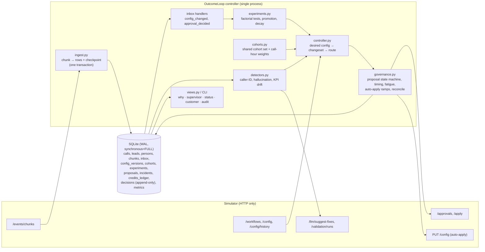

## 4. Architecture

One process, one SQLite file, one synchronous loop. The simulator only moves when we call `/sim/advance`, so
concurrency would buy nothing; determinism and crash-safety buy a lot. Every box below is a module in
`src/outcomeloop/`.

**Per 15-minute tick:** governance tick (poll open approvals; apply approved ones after checking the base is
still current) → hourly (or immediately after a supervisor prompt edit) a decision per workflow → advance →
ingest new chunks → handle inbox events → record loop metrics.

**Decision per workflow** (`Controller.decide`): caller-ID health → hallucination check → (12:00) KPI drift
alert → experiment step (design / look / harm watch / decay check) → build the *desired* config on top of the
*live* config from our own state → diff → route (approval, auto-apply, or hold with a recorded reason).

**State.** Everything that matters is in the SQLite file: raw call rows (integer-encoded, features joined in),
leads/persons, the chunk checkpoint, our view of every config version, cohorts, experiments (full JSON state),
proposals (intent + body + remote state), incidents, credit ledger, the append-only decision log and metrics.
Nothing is held only in memory except caches rebuilt on start (feature arrays, code dictionaries).

**On restart.** (1) If the simulator is a *different world* (scenario name, or first history chunk id, or our
checkpoint is ahead of the simulator's clock) the old DB is archived and we start clean. (2) Otherwise we
ingest any chunks after our checkpoint, reconcile every proposal left in `SUBMITTING`/`APPLYING`/`AUTO_APPLYING`
against `/approvals` and `/config/history`, re-run unhandled inbox events (idempotent), and carry on. `run.sh`
itself restarts the controller if it exits abnormally.

## 5. The learning loop

### Cohorts
* **One shared object.** A cohort is `{cohort_id, where}` with the simulator's semantics; a workflow has one
  ordered cohort set, first-match, else `default`. The same set is written into `config.cohorts`, used by every
  analysis query (one SQL implementation, `membership_sql`), and shown in the supervisor view.
  `check_cohort_agreement` verifies it daily against the `cohort_id` the simulator stamps on each call (0
  mismatches across 95k calls on public_02).
* **How they're formed (C3, from history).** For each lead feature we test whether its values have different
  hour-of-day pickup profiles: binomial deviance G² of `pickup ~ hour × feature` against the additive model,
  likelihood-ratio test (p < 0.001), and pick the feature with the largest G² per degree of freedom. On all
  three public workflows this picks `age_band` (G²/df 4.6–8.2 vs ≤ 2 for the others); nothing is hard-coded,
  a hidden scenario with a different driver would get a different partition, or none.
* **Minimum size and fragmentation.** Groups under **10 % of dials** are merged with a neighbour, **max 6
  cohorts**. Reason: a cohort must be able to support a per-cohort comparison. At ~1,000 connected calls/day,
  10 % is ~100/day, so a cohort-level harm check reaches the 200-call floor in ~2 days. Smaller cohorts
  would never accumulate evidence inside a scenario. Experiments run on the `default` allocation (all cohorts
  share it) so traffic is never split by cohort unless a cohort-specific decision is made.

### Experiment design (C6)
* **Factorial.** `welcome_message` and `voice` are sampled independently per dial, so one experiment per
  dimension runs concurrently and each is analysed on *all* traffic (marginal over the other). We assume no
  welcome × voice interaction (see §13).
* **Allocation.** Incumbent keeps 60 %, challengers split 40 %. Dunnett's √k rule would give challengers
  ~60 % for maximum power; we trade some power for bounded exposure (Compliance: slow and right).
* **Sample size.** Planned n per challenger for a 10 % relative MDE at α 0.05 family-wise, power 0.8,
  at the workflow's own historical engagement, capped by what 5 days of traffic can deliver. The **achieved
  MDE** at that n is recorded on the experiment and shown in the proposal, so an under-powered test is visible
  as such. Product's question, "what does it cost": at nw_renewal volumes a 3-arm welcome test resolves a ~10 %
  lift in 2–4 days; at 5 % MDE it would need ~4× the data, beyond a 10-day scenario.
* **Exploration vs exploitation.** Explore at a fixed 40 % until a pre-registered rule decides, then exploit
  (85 % winner, 15 % holdout). Hourly harm watch: any challenger significantly worse (z < −2.33 on ≥ 200
  connected) is dropped and blacklisted for 14 days, so exploration cost is bounded early.

### Deciding a winner
* **Metric.** Experiments always decide on engagement: welcome and voice are heard only after connect, so they
  cannot move pickup. On a pickup-primary workflow (`nw_kyc`) this improves the guardrail KPI and the business
  outcome, and pickup per arm is still checked as a guardrail; the primary KPI there is moved by caller ID and
  call-hour weights.
* **Test.** One-sided two-proportion z-test on engagement (engaged ÷ connected) of each challenger vs the
  incumbent, using only calls that actually ran with that variant under the experiment's config versions
  (Product: only what happened counts).
* **Stopping rule.** Daily looks at the approver's start hour. Lan-DeMets **O'Brien-Fleming** spending
  `α(t) = 2 − 2Φ(z_{α/2}/√t)` with information fraction `t = n / n_plan`; each look's nominal level is the
  increment of spent α, and α is tracked as an **explicit budget** on the experiment, so the family-wise
  false-winner rate stays ≤ 0.05 across looks (Bonferroni over looks, conservative). At the horizon, if
  the best challenger trends positive, a single **pre-registered extension** doubles the horizon (half of
  the remaining α is reserved for it at the first horizon).
* **Multiple comparisons.** Each look's α is split: 80 % to Holm step-down across challengers, 20 % to the
  cohort-level family (found by our own audit: testing both families at the full α allowed up to 2α). Cohort-specific winners
  (when there is no pooled winner) use Bonferroni across cohorts on top.
* **Before promoting:** guardrail check (below); **cohort harm check**: any cohort where the winner is worse at
  z < −1.645 keeps the incumbent via a per-cohort allocation; **stability check**: the last-24h lift must not be
  ≤ 0 or significantly below the whole-window lift (guards against promoting an effect that is already wearing
  off). Ties: highest 80 % lower confidence bound, then option order. No randomness anywhere in decisions.
* **Fresh at apply time.** A promotion waiting on governance (approver latency, a stale base after a supervisor
  edit, a rejection) is re-checked every tick and **withdrawn** if its effect has faded; the test continues. Our
  strict-policy scenario showed a winner decided at D4 and applied 30 h later, after it had decayed.
* **False-winner rate.** ≤ 5 % per (workflow, dimension) by construction (Holm × spending budget). Evidence from
  the runs: winners promoted on public_01/02 are listed in §11 with the grader's verdict.

### Decay and rollback (C7)
* After promotion, the previous incumbent keeps a **15 % holdout**, giving a concurrent control.
* Hourly, over the last 24 h (widened to 48 h / 72 h until the holdout has ≥ 120 connected calls — a 15 % holdout
  on a small workflow collects ~100 a day), we test the winner-vs-holdout lift against the **80 % lower confidence bound of
  the lift measured at promotion** (not its point estimate: the estimate taken at the moment a test first
  crosses a boundary is biased upward, the winner's curse; our first version rolled back a genuine winner for
  exactly this reason). Rollback when `z < −2.33`, or when the recent lift is itself negative at `z < −2.33` (both
  at the 1 % level because the check repeats hourly over overlapping windows; at 5 % our suite showed false
  rollbacks of genuine winners). Under `next_campaign_only`, calls from older campaigns still running the experiment
  allocation count: they are concurrent, randomised comparisons of the same arms.
* Rollback = proposal back to the holdout option; the decayed option is blacklisted for 7 days.
* How fast: the share of in-population calls still on the decaying `W3` after its decay onset, by simulated day,
  from the grader {{DECAY_EVIDENCE}} — typically 2–4 days from onset to 0 %. The limit is power: a 15 % holdout gets ~150 connected calls/day on nw_renewal.

### Call time and caller ID (C4, C5)
* **History (C3).** 14 days (7 on load) of calls under the business default give per-cohort hour-of-day pickup
  profiles. Weights: `(p̂(cohort,h)/p̄(cohort))²`, empirical-Bayes-smoothed toward the workflow hour profile with
  200 pseudo-dials, clipped to [0.25, 4]. Never 0: a 0 strands capacity when every eligible lead has weight 0.
  Dry run: historical re-weighting at fixed per-hour dial volume (+1.5–1.8 % pickup on public_01, stated as an
  upper bound because it ignores lead-pool depletion).
* **Per-cohort, not per-person.** Per-person `lead_preferred_hour` is cut: a returning person has a handful of
  past dials at ~30 % pickup, and the simulator multiplies weight by 0.25 outside the preferred hour, so a wrong
  guess actively hurts that lead.
* **Caller ID.** Per-dial randomisation means a number's pickup vs the pooled other numbers in the same window
  isolates the number. **Degraded** = ratio < 0.85 and z < −3.5 on ≥ 300 dials in a 6 h or 24 h window **and**,
  for a number with a week of its own history, a drop of > 15 % against that history (z < −3). The second
  condition separates a spam flag (a sudden drop) from volume fatigue (a steady state next to a fresh number);
  without it the controller once ramped a merely tired number out and put 100 % of traffic on one number, which
  the crash-recovery comparison exposed. **Healthy** = the ratio's ~84 % lower bound ≥ 0.85 on ≥ 150 dials
  (24 h, or 72 h so a 5 % probe on a small workflow can complete). Evidence for a re-probed number only counts
  from the start of its probe. **Target** = equal split over healthy numbers (lowest per-number volume), 0 for
  degraded, untested numbers share a probe budget of at most 10 % (5 % each); a number whose health is still unknown
  keeps the share it has (insufficient evidence never moves traffic between healthy and unknown), but a
  measured-degraded number **always** gives up its share — to numbers already carrying traffic first, otherwise to
  the untested ones (an untested number is a better bet than one measured as flagged). A degraded number rests (24 h, doubling), then gets a time-boxed
  2 % re-probe.
* **Exploration of numbers** is the probe share; it is auto-applied where policy allows (operational dim).

### Guardrail KPI
* Every challenger's guardrail KPI is compared with the incumbent's: block promotion if the point drop exceeds
  the policy margin (read as an absolute rate drop, assumption 1), or if a statistically significant drop
  (z < −1.645) exceeds half the margin.
* Workflow-level drift alerts at 12:00 daily (last 24 h vs previous 7 days, > 5 % relative and z > 3).
* For prompt fixes, engagement is verified after the change (§7).
