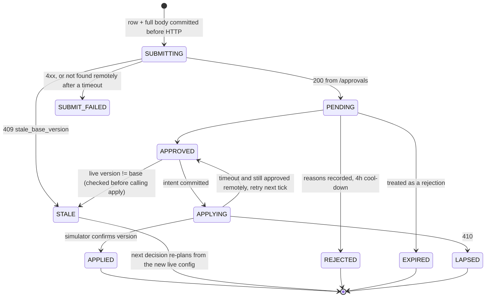

## 6. Governance

### Proposal lifecycle (ours, `governance.py`)

`PENDING/APPROVED → WITHDRAWN` when we no longer want a change (e.g. a promotion whose effect faded while the
request waited): never applied, still counted toward fatigue. **Emergency proposals apply first**; a routine
approval waits while an emergency for the same workflow is open, so our own change cannot make the safety fix
stale.

Auto route: `AUTO_APPLYING → APPLIED | AUTO_DENIED (403) | AUTO_FAILED` — a 403 sends those dims to the approval
route for 24 h, and a dimension last set by a supervisor is approval-only until one of our approved changes to it
lands. Reconciled via
`/config/history` (which records our `proposal_id`) after a timeout.

**Re-proposal is a re-plan, not a resubmit.** Every decision computes the desired config from our state on
top of the *current live* config. A stale, expired, rejected or lapsed proposal is therefore never resent:
the next plan starts from fresh data and the new base (Product: expired = rejection).

### Batching and timing
* **One open proposal per workflow.** Approvals can't be withdrawn, so two open ones race to a stale base.
  Everything we want for a workflow is batched into one changeset: cohorts + schedule + caller IDs + experiment
  starts went out as a single request on D0.
* **When we send.** Only inside approver hours, after the tenant's preferred start (Kestrel: 11:00), and only
  if the *worst-case* decision time `next_working(now + latency_max)` falls before expiry (for an emergency — a
  flagged caller ID or an unsafe prompt — the *best-case* time is enough: an expired emergency request costs one
  slot, waiting costs customers; an emergency may also overtake a pending routine proposal). On `nw_kyc`
  (latency up to 8 h, hours 10–18) that means early in the day.
* **Fatigue.** Trailing-24h count of every request (rejected and expired count too) < `min(policy, tenant
  preference)`, with **one slot reserved for incidents**. Effect: ≤ 1 routine request/day on `ks_cancel` and
  `nw_kyc`, ≤ 2 on `nw_renewal`. Peak requests/24h on the public runs: {{PEAK_REQ}}.
* **Apply window.** We poll every 15 simulated minutes, so an approval is applied within one tick (2 h window).
  Lapsed approvals on the public runs: {{LAPSED}}.

### Auto-apply: when we use it and when we don't
* **Used** only for operational dims (`caller_id`, `schedule`) and only where the policy allows them, within
  `max_shift`. A bigger caller-ID move (e.g. leaving a spam-flagged number on `ks_cancel`, `max_shift 0.2`) is
  ramped in ≤ max_shift steps ≥ 1 h apart, each re-planned from fresh health data, cumulative ≤ 3×max_shift
  per day. On public_02 the flagged number went from 50 % to ~0 % in two steps (12:00, 13:00).
* **Voluntarily not used** for welcome, voice, prompt, cohorts, even where `ks_cancel` would allow welcome/voice:
  Kestrel's supervisor asked to be told before anything customer-facing changes on running campaigns
  (`mid_flight: allowed`), and Northwind's compliance requires a human approval. Cost: slower experiments on
  Kestrel (one routine request/day).

### Impact score, affected leads, dry run (how honest)
* `impact_score = clip(lift_LCB80 / 0.10, 0, 1) × (1 − holdout share)` for a promotion; pure exploration 0.15 (learning,
  no proven lift), schedule = dry-run lift halved (the dry run is an upper bound), urgent caller-ID 0.7,
  validated safety fix 0.9. Components are in `evidence.impact_detail` so the queue order is explainable.
  It is ordinal, not a forecast.
* `affected_leads` = active leads (not concluded, inside cadence) for `mid_flight: allowed`; for
  `next_campaign_only` customer-facing changes, the next campaign's size (they only reach new campaigns).
* `dry_run` replays our own recorded calls: per-arm/per-cohort observed rates (with n, z) for variants,
  historical re-weighting for schedule, per-number pickup for caller ID, validation runs + observed flag rates
  for prompts. Each dry run states its window and known bias. For an exploration (never-tried variants) the dry
  run is the test design itself — arms, planned n and the achievable MDE — not a predicted lift.

### Supervisor edits mid-experiment
`config_changed` with `actor: supervisor` → the changed dims are **locked for 48 h** (no proposals touch
them), an experiment on that dimension is **aborted** (its arms are no longer what we designed; mixing would
contaminate the comparison), other dimensions' experiments continue (independent randomisation), and any open
proposal on the old base will be found stale at apply time and re-planned without the locked dims. On public_02
(`nw_renewal`, D5 15:00, voice → V2) the voice dimension was locked, nothing of ours overwrote it, and the next
voice test 48 h later kept the supervisor's V2 as the incumbent. The one exception is safety: a supervisor's
unsafe prompt is reverted **only via an approval request that says so**, with validation evidence (§7).

## 7. Incidents

### Hallucination (C8)
* **Detection.** QA-flag rate on the live prompt (since its last change, ≤ 24 h) vs the workflow's own
  history rate; fires at rate > 1.5× reference, z > 3.5, ≥ 250 connected calls. A supervisor prompt edit also
  triggers an immediate **validation probe** of the new prompt (300 synthetic calls, 3 credits): the earliest
  population-level evidence, available before enough real calls accrue.
* **False positives.** The flag detector is noisy. Our first version opened an incident on the production
  prompt from a QA-flag tail event and swapped in a "strict" script that cut engagement 14 %. Now an
  incident from flags alone needs **a second, independent signal** unless the production signal is overwhelming
  (≥ 2× baseline, z ≥ 5 on ≥ 400 calls): we validate the live prompt, and only a *clearly* safe result — at least
  the threshold plus one standard error — vetoes the incident; a result inside the threshold's noise band gives
  the benefit of the doubt to safety. Per-look false-alarm probability ≈ 2×10⁻⁴ (z 3.5) × P(production prompt fails
  validation) ≈ 10⁻³ *(derived from the binomial at n=300)*, so a false prompt change is ~10⁻⁶ per look.
* **Choosing a fix (LLM proposes, never decides).** Candidates in order: (1) prompts with ≥ 1,000 connected
  calls in our own history and a normal flag rate, ordered by observed engagement (validation says nothing about
  engagement); (2) only if none validates, `/llm/suggest-fixes` (3 credits). Each candidate is validated
  (n = 300 while credits ≥ 60, 200 while ≥ 20, else 100 — a 100-call run still separates a 1 % from a 5 % failure
  rate, and running out mid-incident is the worse failure); the first that passes `min_validation_pass_rate` (read
  from the policy) wins. Deterministic. A probe result within one standard error of the threshold is treated as a
  coin flip: a second run is bought next tick and the decision uses the pooled sample.
* **Verification after apply.** After 4 h: flag rate back under the detector threshold **and** engagement on
  the new prompt not > 5 % below the pre-incident week (z < −2). A safe-but-disengaging fix (Kestrel memo:
  "nobody hallucinated, nobody stayed") is marked harmful and the next candidate is tried.
* **Credits.** 40 % of the starting budget is reserved for incidents; routine work cannot spend it (routine
  work currently spends nothing). Credits used: public_01 {{CRED01}}, public_02 {{CRED02}} of 200.

### Caller-ID incident (C5) — see §5. Detection uses a 6 h window so a flag is visible within ~2 h of dialling.

### public_02 timeline (from our audit store, `python -m outcomeloop audit --wf ks_cancel`)
{{P02_TIMELINE}}

## 12. Trade-offs & rejected alternatives

| Option | Why considered | Why rejected / what instead |
|---|---|---|
| Thompson sampling / bandit allocation | Less regret during exploration | Every allocation change costs an approval (1–2/day); a bandit needs frequent re-allocation. Fixed 60/40 + early harm drop + sequential test fits the governance budget and gives a clean false-winner guarantee. |
| Bayesian "probability to beat" winner rule | Intuitive for supervisors | Needs a prior and a decision threshold whose false-winner rate under optional stopping is not controlled by default. OBF spending + Holm gives a defensible α. We show lifts and z in the supervisor view instead. |
| Fixed-horizon test only | Simplest valid test | Wastes days when a winner is obvious; sequential looks with α spending stop early without inflating error. |
| Per-person call time applied to everyone | Product's summit headline | A wrong guess costs 0.25× weight; instead it runs as a randomised, self-terminating experiment and is kept only on evidence. Cohort-level weights capture the archetype signal from history. Cut. |
| Postgres + Redis in the assignment | SRE already runs them | Embedded SQLite = zero infrastructure on the grader box; schema is plain SQL, ports to Postgres. Redis adds nothing a durable checkpoint doesn't. |
| Keep raw events only in memory, aggregates in DB | Faster | Compliance's "why did this customer hear this" needs per-call rows; recovery is simpler when the rows are the checkpointed truth. |
| Auto-apply customer-facing changes where policy allows | Faster learning on Kestrel | Kestrel's supervisor asked to be told first; we route them through approval and accept the speed cost. |
| Revert to incumbent at horizon unconditionally | Strict "no evidence → no change" | Under-powered tests then reverted genuinely better challengers. One pre-registered extension with an explicit α budget keeps the error guarantee. |
| Decide every tick (15 min) | Fresher | Hourly is enough for every detector's minimum n; incidents trigger an immediate decision anyway. Halves load at scale. |
| Rotate a degraded caller ID via approval everywhere | Maximum control | Where policy allows it, waiting for an approver while a spam-flagged number burns pickup is the riskier choice. |

## 13. Known weaknesses

1. **Interaction is checked only where it matters most.** Before promotion the winner's lift is re-estimated
   within the other dimension's dominant option and blocked if it does not win there; a full welcome × voice
   interaction model (all cells) is not fitted — with these volumes most cells would be too thin to test.
2. **Effects that exist only in a subgroup not aligned with the cohort set** (e.g. `lang = ta` when cohorts
   are by age) are only found if large enough to show pooled. A slice-based heterogeneity search that proposes a
   refined cohort set is designed (§5) but not built.
3. **Power is the binding constraint**, not code: on ~600–1,000 connected calls/day a 10 % MDE takes days, and
   decay detection with a 15 % holdout takes 1–2 days after a decay completes.
4. **Exploration has a cost.** Starting a test exposes 40 % of traffic to unproven options; the grader marks
   some launches "harmful" by hidden truth ({{HARM_SUMMARY}}). Harm stopping limits it; it can't remove it.
5. **Caller-ID fatigue is handled reactively** (relative pickup), not with a load model. A model of
   pickup vs per-number volume would allow planned rotation.
6. **Dry runs ignore lead-pool depletion** for schedule changes (stated as an upper bound).
7. **Credit-spending calls have no idempotency key.** A crash between sending a validation run and recording
   its result can spend credits twice (bounded: ≤ 3 credits per crash). The ledger marks such rows `sent`.
8. **Single process, single SQLite writer.** Fine at public_03 scale (§8); at 10× it is the first thing to
   change.
9. **Named approver.** The approval API exposes no approver identity, so "who approved" is the approval id
   and timestamp.
10. **Tenant preferences are a static JSON file.** In production they belong in the tenant's policy record.

## 14. If this went to production at Formi next month

1. **Shadow mode first (week 1).** Run the loop read-only against production events: detectors, experiment
   designs and proposals recorded, nothing submitted. Compare its caller-ID and incident calls with what
   on-call actually did.
2. **Storage on the platform's Postgres.** Same schema; `calls` partitioned by day, a rollup table per
   (workflow, hour, cohort, variant) maintained at ingest so decision queries don't scan raw rows. Raw-call
   retention set with Compliance (IRDAI answerability).
3. **Partition the loop by workflow.** One worker per shard of workflows (hash of workflow_id), each with its
   own checkpoint; tenants never share a credit pool without a per-tenant cap (C15).
4. **Paging.** Wire `status` signals to the pager: ingest lag > 30 min, credits within 10 % of the incident
   reserve, approval approved-but-not-applied > 60 min, error rate > N/hour, controller restarts > 3/hour.
   Caller-ID and KPI drift go to the supervisor view, not the pager.
5. **Supervisor view as an API** (the CLI's queries behind an endpoint) and the weekly summary Compliance asked
   for, generated from the decision log.
6. **One workflow live with full approval routing for two weeks**, then expand by policy class.
